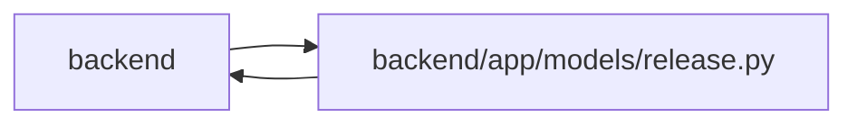

# release Module

**Path:** `backend/app/models/release.py`

## Description

Release model for shipped-work tracking.

## Imports

| Source | Symbols |
|--------|---------|
| `app.database` | `Base` |
| `app.models.external_link` | `ExternalLink` |
| `app.models.project` | `Project` |
| `app.models.task` | `Task` |
| `app.utils.time` | `UTCDateTime`, `utc_now` |
| `datetime` | `date`, `datetime` |
| `enum` | `Enum` |
| `sqlalchemy` | `CheckConstraint`, `Column`, `Date`, `ForeignKey`, `Index`, `Integer`, `String`, `Table`, `Text`, `and_` |
| `sqlalchemy.orm` | `Mapped`, `foreign`, `mapped_column`, `relationship` |
| `typing` | `TYPE_CHECKING`, `Optional` |

## Local dependency map

<!-- Auto-generated local dependency summary. Do not edit by hand. -->

> Module-level dependencies exceed the generated-diagram limits, so the diagram and table below group them by top-level package. Counts report the number of module neighbors in each package.

### Internal neighbors

| Direction | Module |
|---|---|
| Inbound | `backend` (8) |
| Outbound | `backend` (5) |

### External packages

| Language | Used packages | Undeclared packages |
|---|---:|---:|
| python | 1 | 0 |

> All 12 module neighbor(s) are summarized by package because the module-level view exceeds the 12-node limit.

## Classes

| Class | Kind | Line | Bases / Target | Description |
|-------|------|------|----------------|-------------|
| [ReleaseStatus](../entities/models_release_ReleaseStatus.md) | Enum | 29 | `str`, `Enum` | Release lifecycle independent of task status. |
| [Release](../entities/models_release_Release.md) | Class | 60 | `Base` | Lightweight shipping record scoped to one project. |
