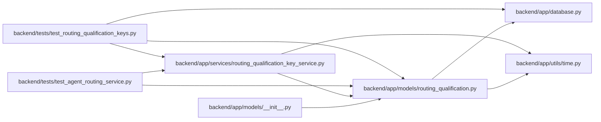

# routing_qualification Module

**Path:** `backend/app/models/routing_qualification.py`

## Description

A deployment's declared qualification keys and their append-only revisions.

## Imports

| Source | Symbols |
|--------|---------|
| `app.database` | `Base` |
| `app.utils.time` | `UTCDateTime`, `utc_now` |
| `datetime` | `datetime` |
| `sqlalchemy` | `CheckConstraint`, `ForeignKey`, `Index`, `Integer`, `String`, `Text`, `UniqueConstraint` |
| `sqlalchemy.orm` | `Mapped`, `mapped_column`, `relationship` |
| `typing` | `Optional` |

## Local dependency map

<!-- Auto-generated local dependency summary. Do not edit by hand. -->

### Internal neighbors

| Direction | Module |
|---|---|
| Inbound | [models___init__](../modules/models___init__.md) |
| Inbound | [routing_qualification_key_service](../modules/routing_qualification_key_service.md) |
| Inbound | [test_agent_routing_service](../modules/test_agent_routing_service.md) |
| Inbound | [test_routing_qualification_keys](../modules/test_routing_qualification_keys.md) |
| Outbound | [app_database](../modules/app_database.md) |
| Outbound | [time](../modules/time.md) |

### External packages

| Language | Used packages | Undeclared packages |
|---|---:|---:|
| python | 1 | 0 |

## Classes

| Class | Line | Bases | Description |
|-------|------|-------|-------------|
| [RoutingQualificationKey](../entities/models_routing_qualification_RoutingQualificationKey.md) | 16 | `Base` | One deployment-declared key that catalog entries and task requirements may name. |
| [RoutingQualificationKeyRevision](../entities/models_routing_qualification_RoutingQualificationKeyRevision.md) | 54 | `Base` | The state a key had after one declare, revise or retire command, and why. |
