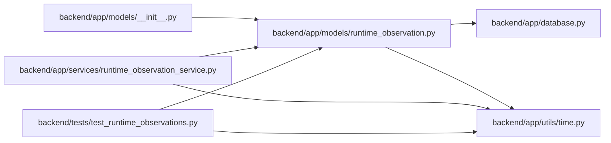

# runtime_observation Module

**Path:** `backend/app/models/runtime_observation.py`

## Description

Advisory observations of agent runtime sessions, reported by independent observers.

## Imports

| Source | Symbols |
|--------|---------|
| `app.database` | `Base` |
| `app.utils.time` | `UTCDateTime`, `utc_now` |
| `datetime` | `datetime` |
| `sqlalchemy` | `CheckConstraint`, `ForeignKey`, `Index`, `Integer`, `String`, `UniqueConstraint`, `event` |
| `sqlalchemy.orm` | `Mapped`, `mapped_column` |

## Local dependency map

<!-- Auto-generated local dependency summary. Do not edit by hand. -->

### Internal neighbors

| Direction | Module |
|---|---|
| Inbound | [models___init__](../modules/models___init__.md) |
| Inbound | [runtime_observation_service](../modules/runtime_observation_service.md) |
| Inbound | [test_runtime_observations](../modules/test_runtime_observations.md) |
| Outbound | [app_database](../modules/app_database.md) |
| Outbound | [time](../modules/time.md) |

### External packages

| Language | Used packages | Undeclared packages |
|---|---:|---:|
| python | 1 | 0 |

## Classes

| Class | Line | Bases | Description |
|-------|------|-------|-------------|
| [AgentRuntimeObservation](../entities/AgentRuntimeObservation.md) | 14 | `Base` | What an independent observer saw of an agent runtime session. |

## Functions

| Function | Signature | Decorators | Description |
|----------|-----------|------------|-------------|
| `immutable_observation` | `(*_args)` | — | — |
