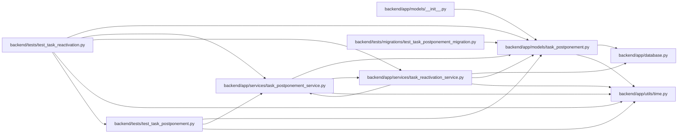

# task_postponement Module

**Path:** `backend/app/models/task_postponement.py`

## Description

A recorded decision that stopped a task, and what must be true before it resumes.

## Imports

| Source | Symbols |
|--------|---------|
| `app.database` | `Base` |
| `app.utils.time` | `UTCDateTime`, `utc_now` |
| `datetime` | `date`, `datetime` |
| `sqlalchemy` | `JSON`, `CheckConstraint`, `Date`, `ForeignKey`, `Index`, `Integer`, `String`, `Text`, `text` |
| `sqlalchemy.orm` | `Mapped`, `mapped_column` |

## Local dependency map

<!-- Auto-generated local dependency summary. Do not edit by hand. -->

### Internal neighbors

| Direction | Module |
|---|---|
| Inbound | [models___init__](../modules/models___init__.md) |
| Inbound | [task_postponement_service](../modules/task_postponement_service.md) |
| Inbound | [task_reactivation_service](../modules/task_reactivation_service.md) |
| Inbound | [test_task_postponement_migration](../modules/test_task_postponement_migration.md) |
| Inbound | [test_task_postponement](../modules/test_task_postponement.md) |
| Inbound | [test_task_reactivation](../modules/test_task_reactivation.md) |
| Outbound | [app_database](../modules/app_database.md) |
| Outbound | [time](../modules/time.md) |

### External packages

| Language | Used packages | Undeclared packages |
|---|---:|---:|
| python | 1 | 0 |

## Classes

| Class | Line | Bases | Description |
|-------|------|-------|-------------|
| [TaskPostponement](../entities/TaskPostponement.md) | 18 | `Base` | One postponement of one task, kept after reactivation as its history. |
| [TaskReactivationRequirement](../entities/TaskReactivationRequirement.md) | 66 | `Base` | One condition a postponement waits for. |
