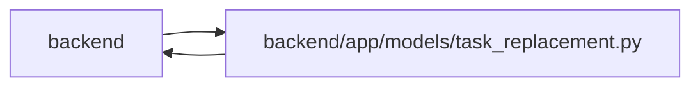

# task_replacement Module

**Path:** `backend/app/models/task_replacement.py`

## Description

An audited disposition that names the one task delivering another task's work instead.

## Imports

| Source | Symbols |
|--------|---------|
| `app.database` | `Base` |
| `app.models.task` | `Task` |
| `app.utils.time` | `UTCDateTime`, `utc_now` |
| `datetime` | `datetime` |
| `sqlalchemy` | `JSON`, `CheckConstraint`, `ForeignKey`, `Index`, `Integer`, `String`, `Text`, `UniqueConstraint`, `case`, `select` |
| `sqlalchemy.orm` | `Mapped`, `column_property`, `mapped_column` |

## Local dependency map

<!-- Auto-generated local dependency summary. Do not edit by hand. -->

> Module-level dependencies exceed the generated-diagram limits, so the diagram and table below group them by top-level package. Counts report the number of module neighbors in each package.

### Internal neighbors

| Direction | Module |
|---|---|
| Inbound | `backend` (10) |
| Outbound | `backend` (3) |

### External packages

| Language | Used packages | Undeclared packages |
|---|---:|---:|
| python | 1 | 0 |

> All 13 module neighbor(s) are summarized by package because the module-level view exceeds the 12-node limit.

## Classes

| Class | Line | Bases | Description |
|-------|------|-------|-------------|
| [TaskReplacement](../entities/TaskReplacement.md) | 13 | `Base` | Link an original task to the one task that delivers its work instead. |
