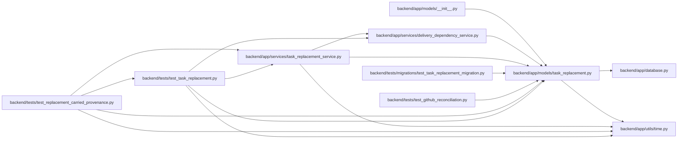

# task_replacement Module

**Path:** `backend/app/models/task_replacement.py`

## Description

An audited disposition that replaces unattributable work with a separate clean task.

## Imports

| Source | Symbols |
|--------|---------|
| `app.database` | `Base` |
| `app.utils.time` | `UTCDateTime`, `utc_now` |
| `datetime` | `datetime` |
| `sqlalchemy` | `JSON`, `CheckConstraint`, `ForeignKey`, `Index`, `Integer`, `String`, `Text`, `UniqueConstraint` |
| `sqlalchemy.orm` | `Mapped`, `mapped_column` |

## Local dependency map

<!-- Auto-generated local dependency summary. Do not edit by hand. -->

### Internal neighbors

| Direction | Module |
|---|---|
| Inbound | [models___init__](../modules/models___init__.md) |
| Inbound | [delivery_dependency_service](../modules/delivery_dependency_service.md) |
| Inbound | [task_replacement_service](../modules/task_replacement_service.md) |
| Inbound | [test_task_replacement_migration](../modules/test_task_replacement_migration.md) |
| Inbound | [test_github_reconciliation](../modules/test_github_reconciliation.md) |
| Inbound | [test_replacement_carried_provenance](../modules/test_replacement_carried_provenance.md) |
| Inbound | [test_task_replacement](../modules/test_task_replacement.md) |
| Outbound | [app_database](../modules/app_database.md) |
| Outbound | [time](../modules/time.md) |

### External packages

| Language | Used packages | Undeclared packages |
|---|---:|---:|
| python | 1 | 0 |

## Classes

| Class | Line | Bases | Description |
|-------|------|-------|-------------|
| [TaskReplacement](../entities/TaskReplacement.md) | 12 | `Base` | Link an original task to the one task that delivers its work instead. |
