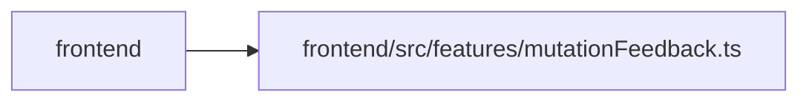

# mutationFeedback Module

**Path:** `frontend/src/features/mutationFeedback.ts`

## Description

_Auto-generated from `frontend/src/features/mutationFeedback.ts`._

## Imports

| Source | Symbols | Type-only | Runtime emission |
|--------|---------|-----------|------------------|
| `i18next` | `TFunction` | Declaration | erased |

## Module Signals

| Signal | Values |
|--------|--------|
| Exports | `FeedbackAction`, `FeedbackKind`, `MutationFeedbackMeta`, `MutationUndo`, `feedbackMessage` |

## Local dependency map

<!-- Auto-generated local dependency summary. Do not edit by hand. -->
This graph shows full source coupling. Type dependencies can be erased; compiler-dependent cycle groups are runtime candidates, not confirmed initialization cycles.

> Module-level dependencies exceed the generated-diagram limits, so the diagram and table below group them by top-level package. Counts report the number of module neighbors in each package.

### Internal neighbors

| Direction | Module |
|---|---|
| Inbound | `frontend` (23) |

### External packages

| Language | Used packages | Undeclared packages |
|---|---:|---:|
| typescript | 1 | 0 |

> All 23 module neighbor(s) are summarized by package because the module-level view exceeds the 12-node limit.

## Classes

| Class | Kind | Line | Bases / Target | Description |
|-------|------|------|----------------|-------------|
| [MutationUndo](../entities/MutationUndo.md) | Interface | 4 | — | A way back from a write the user just made. |
| [MutationFeedbackMeta](../entities/MutationFeedbackMeta.md) | Interface | 15 | `Record<string, unknown>` | Put on a mutation's `meta` to announce its result. One listener shows the |
| [FeedbackAction](../entities/FeedbackAction.md) | Type alias | 21 | `'created' \| 'saved' \| 'deleted'` | — |
| [FeedbackKind](../entities/FeedbackKind.md) | Type alias | 22 | `'project' \| 'release' \| 'milestone' \| 'task' \| 'triageItem' \| 'teamMember' \| 'profile' \| 'initiative' \| 'update' \| 'absence'` | — |

## Functions

| Function | Signature | Decorators | Description |
|----------|-----------|------------|-------------|
| `feedbackMessage` | `(t: TFunction, action: FeedbackAction, kind: FeedbackKind, name?: string \| null)` | — | "Created task “Fix login”." The object is named so the message stands on its own. |
