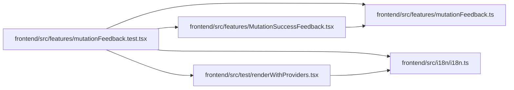

# mutationFeedback.test Module

**Path:** `frontend/src/features/mutationFeedback.test.tsx`

## Description

_Auto-generated from `frontend/src/features/mutationFeedback.test.tsx`._

## Imports

| Source | Symbols | Type-only | Runtime emission |
|--------|---------|-----------|------------------|
| `../i18n/i18n` | `i18n` | — | compiler-dependent |
| `../test/renderWithProviders` | `renderWithProviders` | — | compiler-dependent |
| `./MutationSuccessFeedback` | `MutationSuccessFeedback` | — | compiler-dependent |
| `./mutationFeedback` | `MutationFeedbackMeta` | Declaration | erased |
| `./mutationFeedback` | `feedbackMessage` | — | compiler-dependent |
| `@tanstack/react-query` | `useMutation` | — | compiler-dependent |
| `@testing-library/react` | `screen`, `waitFor` | — | compiler-dependent |
| `vitest` | `describe`, `expect`, `it`, `vi` | — | compiler-dependent |

## Module Signals

| Signal | Values |
|--------|--------|
| Module calls | `describe` |

## Local dependency map

<!-- Auto-generated local dependency summary. Do not edit by hand. -->
This graph shows full source coupling. Type dependencies can be erased; compiler-dependent cycle groups are runtime candidates, not confirmed initialization cycles.

### Internal neighbors

| Direction | Module |
|---|---|
| Outbound | [mutationFeedback](../modules/mutationFeedback.md) |
| Outbound | [MutationSuccessFeedback](../modules/MutationSuccessFeedback.md) |
| Outbound | [i18n](../modules/i18n.md) |
| Outbound | [renderWithProviders](../modules/renderWithProviders.md) |

### External packages

| Language | Used packages | Undeclared packages |
|---|---:|---:|
| typescript | 3 | 0 |
