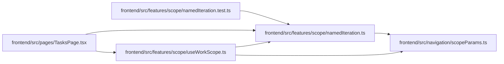

# namedIteration Module

**Path:** `frontend/src/features/scope/namedIteration.ts`

## Description

_Auto-generated from `frontend/src/features/scope/namedIteration.ts`._

## Imports

| Source | Symbols | Type-only | Runtime emission |
|--------|---------|-----------|------------------|
| `../../navigation/scopeParams` | `parseScope` | — | compiler-dependent |

## Module Signals

| Signal | Values |
|--------|--------|
| Exports | `forgetCompletedSearchUnless`, `recordCompletedSearch`, `urlNamesIteration` |

## Local dependency map

<!-- Auto-generated local dependency summary. Do not edit by hand. -->

### Internal neighbors

| Direction | Module |
|---|---|
| Inbound | [namedIteration.test](../modules/namedIteration.test.md) |
| Inbound | [useWorkScope](../modules/useWorkScope.md) |
| Inbound | [TasksPage](../modules/TasksPage.md) |
| Outbound | [scopeParams](../modules/scopeParams.md) |

## Functions

| Function | Signature | Decorators | Description |
|----------|-----------|------------|-------------|
| `recordCompletedSearch` | `(search: string)` | — | The shell records the search it wrote after adding the scope to a URL that named no iteration. |
| `forgetCompletedSearchUnless` | `(search: string)` | — | The shell forgets the record once the URL has moved on to another search. |
| `urlNamesIteration` | `(search: string) -> boolean` | — | True when the URL names the iteration itself: a link, a reload or a scope already chosen. |
