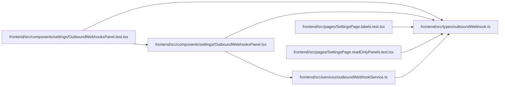

# outboundWebhook Module

**Path:** `frontend/src/types/outboundWebhook.ts`

## Description

_Auto-generated from `frontend/src/types/outboundWebhook.ts`._

## Module Signals

| Signal | Values |
|--------|--------|
| Exports | `OutboundWebhookDelivery`, `OutboundWebhookDeliveryListParams`, `OutboundWebhookDeliveryStatus`, `OutboundWebhookEvent`, `OutboundWebhookRetryResponse`, `OutboundWebhookTarget`, `OutboundWebhookTargetCreate`, `OutboundWebhookTargetUpdate` |

## Local dependency map

<!-- Auto-generated local dependency summary. Do not edit by hand. -->
This graph shows full source coupling. Type dependencies can be erased; compiler-dependent cycle groups are runtime candidates, not confirmed initialization cycles.

### Internal neighbors

| Direction | Module |
|---|---|
| Inbound | [OutboundWebhooksPanel.test](../modules/OutboundWebhooksPanel.test.md) |
| Inbound | [OutboundWebhooksPanel](../modules/OutboundWebhooksPanel.md) |
| Inbound | [SettingsPage.labels.test](../modules/SettingsPage.labels.test.md) |
| Inbound | [SettingsPage.readOnlyPanels.test](../modules/SettingsPage.readOnlyPanels.test.md) |
| Inbound | [outboundWebhookService](../modules/outboundWebhookService.md) |

## Classes

| Class | Kind | Line | Bases / Target | Description |
|-------|------|------|----------------|-------------|
| [OutboundWebhookTarget](../entities/outboundWebhook_OutboundWebhookTarget.md) | Interface | 3 | — | — |
| [OutboundWebhookTargetCreate](../entities/outboundWebhook_OutboundWebhookTargetCreate.md) | Interface | 18 | — | — |
| [OutboundWebhookEvent](../entities/outboundWebhook_OutboundWebhookEvent.md) | Interface | 30 | — | — |
| [OutboundWebhookDelivery](../entities/outboundWebhook_OutboundWebhookDelivery.md) | Interface | 40 | — | — |
| [OutboundWebhookRetryResponse](../entities/outboundWebhook_OutboundWebhookRetryResponse.md) | Interface | 61 | — | — |
| [OutboundWebhookDeliveryListParams](../entities/OutboundWebhookDeliveryListParams.md) | Interface | 65 | — | — |
| [OutboundWebhookDeliveryStatus](../entities/outboundWebhook_OutboundWebhookDeliveryStatus.md) | Type alias | 1 | `'pending' \| 'delivered' \| 'failed'` | — |
| [OutboundWebhookTargetUpdate](../entities/outboundWebhook_OutboundWebhookTargetUpdate.md) | Type alias | 28 | `Partial<OutboundWebhookTargetCreate>` | — |
