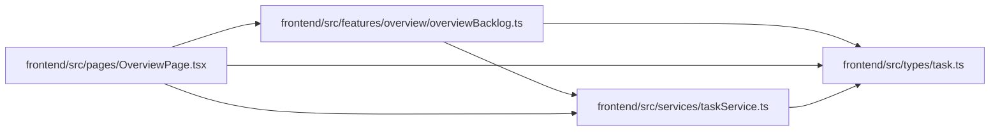

# overviewBacklog Module

**Path:** `frontend/src/features/overview/overviewBacklog.ts`

## Description

_Auto-generated from `frontend/src/features/overview/overviewBacklog.ts`._

## Imports

| Source | Symbols | Type-only | Runtime emission |
|--------|---------|-----------|------------------|
| `../../services/taskService` | `taskService` | — | compiler-dependent |
| `../../types/task` | `TaskReference` | Declaration | erased |

## Module Signals

| Signal | Values |
|--------|--------|
| Exports | `loadProjectBacklog` |
| Constants | `PAGE_SIZE`, `MAX_PAGES` |

## Local dependency map

<!-- Auto-generated local dependency summary. Do not edit by hand. -->
This graph shows full source coupling. Type dependencies can be erased; compiler-dependent cycle groups are runtime candidates, not confirmed initialization cycles.

### Internal neighbors

| Direction | Module |
|---|---|
| Inbound | [OverviewPage](../modules/OverviewPage.md) |
| Outbound | [taskService](../modules/taskService.md) |
| Outbound | [types_task](../modules/types_task.md) |

## Functions

| Function | Signature | Decorators | Description |
|----------|-----------|------------|-------------|
| `loadProjectBacklog` | *(async)* `(projectId: number \| null) -> Promise<TaskReference[]>` | — | Every task of one project's backlog, or of every project's with no project given. Overview counts the whole backlog, so it reads every |
