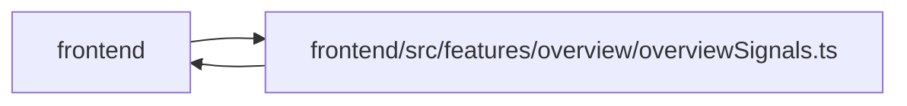

# overviewSignals Module

**Path:** `frontend/src/features/overview/overviewSignals.ts`

## Description

_Auto-generated from `frontend/src/features/overview/overviewSignals.ts`._

## Imports

| Source | Symbols | Type-only | Runtime emission |
|--------|---------|-----------|------------------|
| `../../components/tasks/TaskFiltersBar` | `TaskFilters` | Declaration | erased |
| `../../types/agent` | `AgentPipeline` | Declaration | erased |
| `../../types/iteration` | `Iteration` | Declaration | erased |
| `../../types/task` | `Task`, `TaskReference` | Declaration | erased |
| `../../utils/taskFilterDefaults` | `defaultFilters` | — | compiler-dependent |
| `../../utils/taskState` | `isStoppedState`, `stateOf` | — | compiler-dependent |
| `../../utils/visibleWork` | `selectVisibleWork` | — | compiler-dependent |
| `../savedViews/taskViewParams` | `writeFiltersToSearchParams` | — | compiler-dependent |
| `../scope/workScope` | `ScopeIteration`, `ScopeProject` | Declaration | erased |

## Module Signals

| Signal | Values |
|--------|--------|
| Exports | `ATTENTION_KINDS`, `AttentionCandidate`, `AttentionKind`, `DeliveryRisk`, `OVERVIEW_COUNT_LIST_PARAM`, `OVERVIEW_TASK_LISTS`, `OverviewCountList`, `OverviewTaskList`, `PIPELINE_STAGES`, `PipelineStage`, `backlogRoots`, `calendarDaysLeft`, `daysLeftToLatestEnd`, `deliveryRisk`, `isOpenIteration`, `iterationsInView`, `listTasks`, `overviewCountListHref`, `overviewListFilters`, `parseOverviewCountList`, `pickAttention`, `pipelineStageHref`, `pipelineTasksInScope`, `selectWorkNow`, `taskListHref` |
| Constants | `OVERVIEW_TASK_LISTS`, `PIPELINE_STAGES`, `DONE_STATUSES`, `OVERVIEW_COUNT_LIST_PARAM`, `MS_PER_DAY`, `RISK_RANK`, `ATTENTION_KINDS` |
| Module calls | `DONE_STATUSES = Set` |

## Local dependency map

<!-- Auto-generated local dependency summary. Do not edit by hand. -->
This graph shows full source coupling. Type dependencies can be erased; compiler-dependent cycle groups are runtime candidates, not confirmed initialization cycles.

> Module-level dependencies exceed the generated-diagram limits, so the diagram and table below group them by top-level package. Counts report the number of module neighbors in each package.

### Internal neighbors

| Direction | Module |
|---|---|
| Inbound | `frontend` (3) |
| Outbound | `frontend` (9) |

> All 12 module neighbor(s) are summarized by package because the module-level view exceeds the 12-node limit.

## Classes

| Class | Kind | Line | Bases / Target | Description |
|-------|------|------|----------------|-------------|
| [AttentionCandidate](../entities/AttentionCandidate.md) | Interface | 228 | — | — |
| [OverviewTaskList](../entities/OverviewTaskList.md) | Type alias | 24 | `keyof typeof OVERVIEW_TASK_LISTS` | — |
| [PipelineStage](../entities/PipelineStage.md) | Type alias | 56 | `typeof PIPELINE_STAGES[number]` | — |
| [OverviewCountList](../entities/OverviewCountList.md) | Type alias | 79 | `OverviewTaskList` | A list Overview can show itself, for task counts that no single Tasks list holds: a sum |
| [DeliveryRisk](../entities/DeliveryRisk.md) | Type alias | 186 | `'overdue' \| 'late-start' \| 'outside-limits' \| 'blocked' \| null` | — |
| [AttentionKind](../entities/AttentionKind.md) | Type alias | 226 | `typeof ATTENTION_KINDS[number]` | — |

## Functions

| Function | Signature | Decorators | Description |
|----------|-----------|------------|-------------|
| `overviewListFilters` | `(list: OverviewTaskList) -> TaskFilters` | — | — |
| `listTasks` | `(roots: Task[], list: OverviewTaskList)` | — | The tasks the Tasks list shows for this list: the leaves of the filtered tree. |
| `taskListHref` | `(list: OverviewTaskList, extra: Record<string, string> = {})` | — | The Tasks link that shows `list`; `extra` adds parameters such as a selection mode. |
| `pipelineStageHref` | `(stage: PipelineStage)` | — | The Tasks link that opens the pipeline view on one stage. |
| `pipelineTasksInScope` | `(tasks: Task[], project: ScopeProject \| undefined, iteration: ScopeIteration \| undefined)` | — | The pipeline tasks that belong to one scope, by the rule the pipeline view applies. |
| `parseOverviewCountList` | `(value: string \| null) -> OverviewCountList \| null` | — | — |
| `overviewCountListHref` | `(list: OverviewCountList)` | — | The Overview link that opens one of its own lists; the scope is added by the caller. |
| `backlogRoots` | `(references: TaskReference[]) -> Task[]` | — | Backlog work as Overview reads it. The backlog lookup returns task references, which carry |
| `isOpenIteration` | `(iteration: Pick<Iteration, 'start_date' \| 'end_date'>, today: string)` | — | True when today falls within the iteration's dates. |
| `iterationsInView` | `(iterations: Iteration[], project: ScopeProject \| undefined, iteration: ScopeIteration \| undefined, today: string) -> Iteration[]` | — | The iterations Overview counts: the one in scope. With All projects and no iteration chosen, |
| `calendarDaysLeft` | `(iteration: Pick<Iteration, 'end_date'>, today: string) -> number \| null` | — | Calendar days from today to the iteration's end date; 0 once it has ended. |
| `daysLeftToLatestEnd` | `(iterations: Pick<Iteration, 'id' \| 'end_date'>[], today: string) -> number \| null` | — | Calendar days from today to the latest end among the iterations: with All projects the |
| `deliveryRisk` | `(task: Task) -> DeliveryRisk` | — | Why an open task threatens delivery, most severe reason first. |
| `selectWorkNow` | `(roots: Task[], limit = 5)` | — | The next open tasks to work on, highest delivery risk first, then by due date and priority. |
| `pickAttention` | `(candidates: AttentionCandidate[]) -> AttentionCandidate \| null` | — | The most severe candidate: kinds in severity order, then the larger count, then the earlier iteration. |
