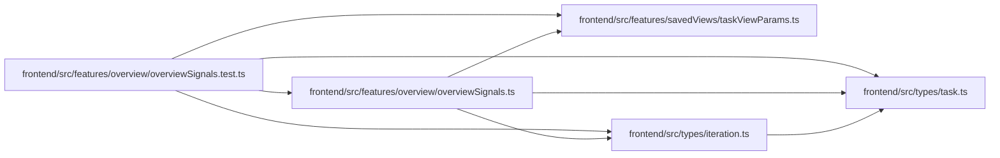

# overviewSignals.test Module

**Path:** `frontend/src/features/overview/overviewSignals.test.ts`

## Description

_Auto-generated from `frontend/src/features/overview/overviewSignals.test.ts`._

## Imports

| Source | Symbols | Type-only | Runtime emission |
|--------|---------|-----------|------------------|
| `../../types/iteration` | `Iteration` | Declaration | erased |
| `../../types/task` | `Task`, `TaskReference` | Declaration | erased |
| `../savedViews/taskViewParams` | `filtersFromSearchParams` | — | compiler-dependent |
| `./overviewSignals` | `backlogRoots`, `calendarDaysLeft`, `daysLeftToLatestEnd`, `iterationsInView`, `listTasks`, `overviewCountListHref`, `parseOverviewCountList`, `pickAttention`, `pipelineTasksInScope`, `selectWorkNow`, `taskListHref` | — | compiler-dependent |
| `vitest` | `describe`, `expect`, `it` | — | compiler-dependent |

## Module Signals

| Signal | Values |
|--------|--------|
| Module calls | `describe`, `describe`, `describe`, `describe` |

## Local dependency map

<!-- Auto-generated local dependency summary. Do not edit by hand. -->
This graph shows full source coupling. Type dependencies can be erased; compiler-dependent cycle groups are runtime candidates, not confirmed initialization cycles.

### Internal neighbors

| Direction | Module |
|---|---|
| Outbound | [overviewSignals](../modules/overviewSignals.md) |
| Outbound | [taskViewParams](../modules/taskViewParams.md) |
| Outbound | [types_iteration](../modules/types_iteration.md) |
| Outbound | [types_task](../modules/types_task.md) |

### External packages

| Language | Used packages | Undeclared packages |
|---|---:|---:|
| typescript | 1 | 0 |
