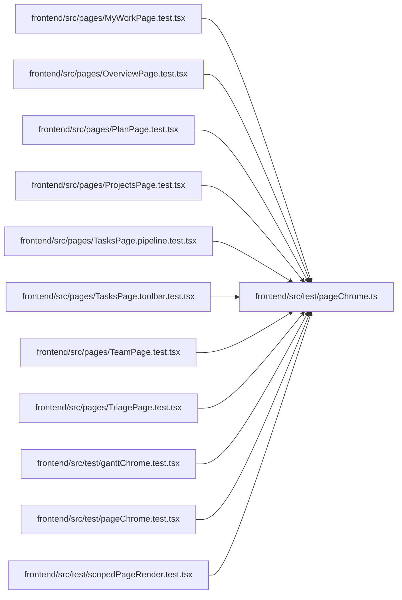

# pageChrome Module

**Path:** `frontend/src/test/pageChrome.ts`

## Description

_Auto-generated from `frontend/src/test/pageChrome.ts`._

## Imports

| Source | Symbols | Type-only | Runtime emission |
|--------|---------|-----------|------------------|
| `dom-accessibility-api` | `computeAccessibleName` | — | compiler-dependent |

## Module Signals

| Signal | Values |
|--------|--------|
| Exports | `expectPageChrome` |

## Local dependency map

<!-- Auto-generated local dependency summary. Do not edit by hand. -->

### Internal neighbors

| Direction | Module |
|---|---|
| Inbound | [MyWorkPage.test](../modules/MyWorkPage.test.md) |
| Inbound | [OverviewPage.test](../modules/OverviewPage.test.md) |
| Inbound | [PlanPage.test](../modules/PlanPage.test.md) |
| Inbound | [ProjectsPage.test](../modules/ProjectsPage.test.md) |
| Inbound | [TasksPage.pipeline.test](../modules/TasksPage.pipeline.test.md) |
| Inbound | [TasksPage.toolbar.test](../modules/TasksPage.toolbar.test.md) |
| Inbound | [TeamPage.test](../modules/TeamPage.test.md) |
| Inbound | [TriagePage.test](../modules/TriagePage.test.md) |
| Inbound | [ganttChrome.test](../modules/ganttChrome.test.md) |
| Inbound | [pageChrome.test](../modules/pageChrome.test.md) |
| Inbound | [scopedPageRender.test](../modules/scopedPageRender.test.md) |

### External packages

| Language | Used packages | Undeclared packages |
|---|---:|---:|
| typescript | 1 | 0 |

## Functions

| Function | Signature | Decorators | Description |
|----------|-----------|------------|-------------|
| `expectPageChrome` | `(container: HTMLElement, options: { status?: 'migrated' \| 'pending' } = {})` | — | — |
