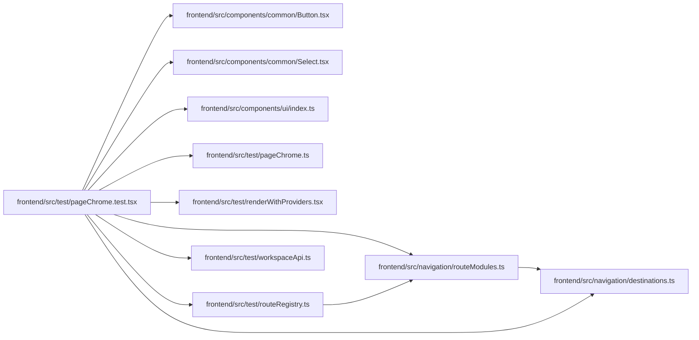

# pageChrome.test Module

**Path:** `frontend/src/test/pageChrome.test.tsx`

## Description

_Auto-generated from `frontend/src/test/pageChrome.test.tsx`._

## Imports

| Source | Symbols | Type-only | Runtime emission |
|--------|---------|-----------|------------------|
| `../components/common/Button` | `Button` | — | compiler-dependent |
| `../components/common/Select` | `Select` | — | compiler-dependent |
| `../components/ui` | `FilterBar`, `PageHeader`, `PageToolbar`, `ViewSwitch` | — | compiler-dependent |
| `../navigation/destinations` | `DESTINATIONS` | — | compiler-dependent |
| `../navigation/routeModules` | `routeMetadata`, `routeModuleLoaders` | — | compiler-dependent |
| `./pageChrome` | `expectPageChrome` | — | compiler-dependent |
| `./renderWithProviders` | `renderWithProviders` | — | compiler-dependent |
| `./routeRegistry` | `routeRegistry` | — | compiler-dependent |
| `./workspaceApi` | `installWorkspaceApi` | — | compiler-dependent |
| `@testing-library/react` | `act`, `waitFor` | — | compiler-dependent |
| `react-router-dom` | `Route`, `Routes` | — | compiler-dependent |
| `vitest` | `afterEach`, `describe`, `expect`, `it`, `vi` | — | compiler-dependent |

## Module Signals

| Signal | Values |
|--------|--------|
| Module calls | `afterEach`, `describe` |

## Local dependency map

<!-- Auto-generated local dependency summary. Do not edit by hand. -->

### Internal neighbors

| Direction | Module |
|---|---|
| Outbound | [Button](../modules/Button.md) |
| Outbound | [Select](../modules/Select.md) |
| Outbound | [index](../modules/index.md) |
| Outbound | [destinations](../modules/destinations.md) |
| Outbound | [routeModules](../modules/routeModules.md) |
| Outbound | [pageChrome](../modules/pageChrome.md) |
| Outbound | [renderWithProviders](../modules/renderWithProviders.md) |
| Outbound | [routeRegistry](../modules/routeRegistry.md) |
| Outbound | [workspaceApi](../modules/workspaceApi.md) |

### External packages

| Language | Used packages | Undeclared packages |
|---|---:|---:|
| typescript | 3 | 0 |
