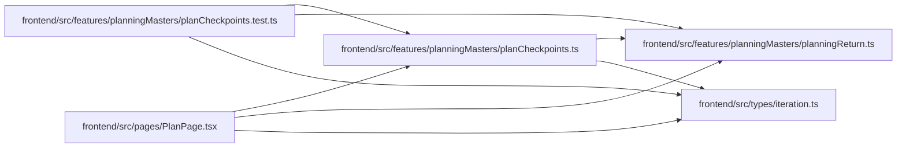

# planCheckpoints Module

**Path:** `frontend/src/features/planningMasters/planCheckpoints.ts`

## Description

_Auto-generated from `frontend/src/features/planningMasters/planCheckpoints.ts`._

## Imports

| Source | Symbols | Type-only | Runtime emission |
|--------|---------|-----------|------------------|
| `../../types/iteration` | `IterationPlanningReadinessSummary`, `PlanCheckpoint` | Declaration | erased |
| `./planningReturn` | `PlanningStepId` | Declaration | erased |
| `./planningReturn` | `PLANNING_STEP_IDS` | — | compiler-dependent |

## Module Signals

| Signal | Values |
|--------|--------|
| Exports | `PlanCheckpointSection`, `PlanCheckpointState`, `firstIncompleteCheckpoint`, `planCheckpointSections` |
| Constants | `WAITS_FOR_BY_REASON` |

## Local dependency map

<!-- Auto-generated local dependency summary. Do not edit by hand. -->
This graph shows full source coupling. Type dependencies can be erased; compiler-dependent cycle groups are runtime candidates, not confirmed initialization cycles.

### Internal neighbors

| Direction | Module |
|---|---|
| Inbound | [planCheckpoints.test](../modules/planCheckpoints.test.md) |
| Inbound | [PlanPage](../modules/PlanPage.md) |
| Outbound | [planningReturn](../modules/planningReturn.md) |
| Outbound | [types_iteration](../modules/types_iteration.md) |

## Classes

| Class | Kind | Line | Bases / Target | Description |
|-------|------|------|----------------|-------------|
| [PlanCheckpointSection](../entities/PlanCheckpointSection.md) | Interface | 8 | — | One plan section as the page shows it, read from the server's planning-readiness response. |
| [PlanCheckpointState](../entities/PlanCheckpointState.md) | Type alias | 5 | `PlanCheckpoint['state']` | — |

## Functions

| Function | Signature | Decorators | Description |
|----------|-----------|------------|-------------|
| `planCheckpointSections` | `(summary: IterationPlanningReadinessSummary \| undefined, { hasIteration }: { hasIteration: boolean }) -> PlanCheckpointSection[] \| null` | — | The six sections in order, with the states exactly as the server reported them. |
| `firstIncompleteCheckpoint` | `(sections: readonly PlanCheckpointSection[]) -> PlanningStepId` | — | The section that opens by default: the first incomplete one, or Review once all are done. |
