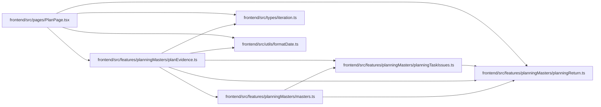

# planEvidence Module

**Path:** `frontend/src/features/planningMasters/planEvidence.ts`

## Description

_Auto-generated from `frontend/src/features/planningMasters/planEvidence.ts`._

## Imports

| Source | Symbols | Type-only | Runtime emission |
|--------|---------|-----------|------------------|
| `../../types/iteration` | `IterationPlanningReadinessSummary` | Declaration | erased |
| `../../utils/formatDate` | `formatDate` | — | compiler-dependent |
| `./masters` | `PlanReadiness` | Declaration | erased |
| `./masters` | `derivePlanningRecovery` | — | compiler-dependent |
| `./planningReturn` | `PlanningStepId` | Declaration | erased |
| `./planningReturn` | `planStepHref`, `withPlanReturn` | — | compiler-dependent |
| `./planningTaskIssues` | `PlanningTaskIssue` | Declaration | erased |
| `./planningTaskIssues` | `PLANNING_ITERATION_PARAM`, `planningIssueTasksHref` | — | compiler-dependent |
| `i18next` | `TFunction` | Declaration | erased |

## Module Signals

| Signal | Values |
|--------|--------|
| Exports | `checkpointEvidence`, `checkpointOwnerLink`, `readinessWithServerCounts` |
| Constants | `OWNER_LABEL_KEYS` |

## Local dependency map

<!-- Auto-generated local dependency summary. Do not edit by hand. -->
This graph shows full source coupling. Type dependencies can be erased; compiler-dependent cycle groups are runtime candidates, not confirmed initialization cycles.

### Internal neighbors

| Direction | Module |
|---|---|
| Inbound | [PlanPage](../modules/PlanPage.md) |
| Outbound | [planningMasters_masters](../modules/planningMasters_masters.md) |
| Outbound | [planningReturn](../modules/planningReturn.md) |
| Outbound | [planningTaskIssues](../modules/planningTaskIssues.md) |
| Outbound | [types_iteration](../modules/types_iteration.md) |
| Outbound | [formatDate](../modules/formatDate.md) |

### External packages

| Language | Used packages | Undeclared packages |
|---|---:|---:|
| typescript | 1 | 0 |

## Classes

| Class | Kind | Line | Bases / Target | Description |
|-------|------|------|----------------|-------------|
| [EvidenceItem](../entities/EvidenceItem.md) | Type alias | 11 | <pre><code>&#123;&#10;    label&#58; string&#59;&#10;    value&#58; string&#59;&#10;    &#47;&#42;&#42; An actionable exception&#58; shown in the exception colour&#46; &#42;&#47;&#10;    exception&#63;&#58; boolean&#59;&#10;    href&#63;&#58; string&#59;&#10;    actionLabel&#63;&#58; string&#59;&#10;&#125;</code></pre> | — |
| [OwnerLink](../entities/OwnerLink.md) | Type alias | 20 | `{ href: string; label: string }` | — |

## Functions

| Function | Signature | Decorators | Description |
|----------|-----------|------------|-------------|
| `readinessWithServerCounts` | `(readiness: PlanReadiness, summary: IterationPlanningReadinessSummary \| undefined) -> PlanReadiness` | — | Takes every count the server's planning-readiness response carries, so evidence and states agree. |
| `checkpointEvidence` | `(stepId: PlanningStepId, readiness: PlanReadiness, t: TFunction, language: string, iterationId: number) -> EvidenceItem[]` | — | The rows of facts a checkpoint shows today, each optionally linking to the records behind it. |
| `checkpointOwnerLink` | `(stepId: PlanningStepId, readiness: PlanReadiness, t: TFunction, iterationId: number) -> OwnerLink` | — | The existing link to the page that owns the change a checkpoint needs. |
