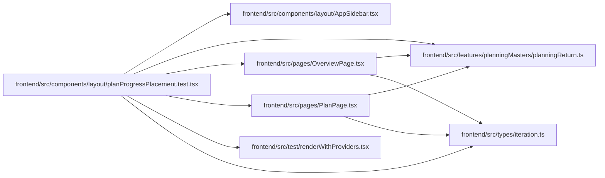

# planProgressPlacement.test Module

**Path:** `frontend/src/components/layout/planProgressPlacement.test.tsx`

## Description

_Auto-generated from `frontend/src/components/layout/planProgressPlacement.test.tsx`._

## Imports

| Source | Symbols | Type-only | Runtime emission |
|--------|---------|-----------|------------------|
| `../../features/planningMasters/planningReturn` | `PLANNING_STEP_IDS` | — | compiler-dependent |
| `../../pages/OverviewPage` | `OverviewPage` | — | compiler-dependent |
| `../../pages/PlanPage` | `PlanPage` | — | compiler-dependent |
| `../../test/renderWithProviders` | `renderWithProviders` | — | compiler-dependent |
| `../../types/iteration` | `Iteration`, `IterationSummary` | Declaration | erased |
| `./AppSidebar` | `AppSidebar` | — | compiler-dependent |
| `@testing-library/react` | `screen`, `within` | — | compiler-dependent |
| `react` | `ReactNode` | Declaration | erased |
| `vitest` | `beforeEach`, `describe`, `expect`, `it`, `vi` | — | compiler-dependent |

## Module Signals

| Signal | Values |
|--------|--------|
| Constants | `mocks`, `iteration`, `iterationSummary`, `PROGRESS_TEXT` |
| Module calls | `mocks = hoisted`, `mock`, `mock`, `mock`, `mock`, `mock`, `describe` |

## Local dependency map

<!-- Auto-generated local dependency summary. Do not edit by hand. -->
This graph shows full source coupling. Type dependencies can be erased; compiler-dependent cycle groups are runtime candidates, not confirmed initialization cycles.

### Internal neighbors

| Direction | Module |
|---|---|
| Outbound | [AppSidebar](../modules/AppSidebar.md) |
| Outbound | [planningReturn](../modules/planningReturn.md) |
| Outbound | [OverviewPage](../modules/OverviewPage.md) |
| Outbound | [PlanPage](../modules/PlanPage.md) |
| Outbound | [renderWithProviders](../modules/renderWithProviders.md) |
| Outbound | [types_iteration](../modules/types_iteration.md) |

### External packages

| Language | Used packages | Undeclared packages |
|---|---:|---:|
| typescript | 3 | 0 |
