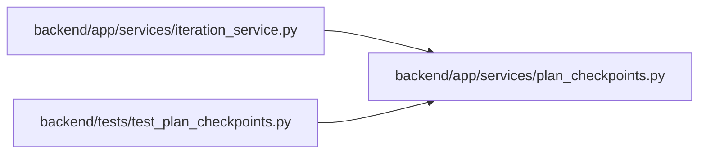

# plan_checkpoints Module

**Path:** `backend/app/services/plan_checkpoints.py`

## Description

The six plan checkpoints people and the PM read, derived once on the server.

The plan page and the PM role skill use these ids, in this order. Each
checkpoint is ``done``, ``warn`` (usable but needs attention), ``todo`` (the
next thing to do), or ``blocked`` (an earlier checkpoint must be done first).

## Imports

| Source | Symbols |
|--------|---------|
| `__future__` | `annotations` |
| `typing` | `Any` |

## Local dependency map

<!-- Auto-generated local dependency summary. Do not edit by hand. -->

### Internal neighbors

| Direction | Module |
|---|---|
| Inbound | [iteration_service](../modules/iteration_service.md) |
| Inbound | [test_plan_checkpoints](../modules/test_plan_checkpoints.md) |

## Functions

| Function | Signature | Decorators | Description |
|----------|-----------|------------|-------------|
| `plan_checkpoints` | `(*, team_member_count: int, team_members_no_capacity: int, task_count: int, tasks_without_assignee: int, tasks_without_effort: int, has_schedule: bool, risk_count: int) -> list[dict[str, Any]]` | — | Return the ordered checkpoints for one existing planning period. |
