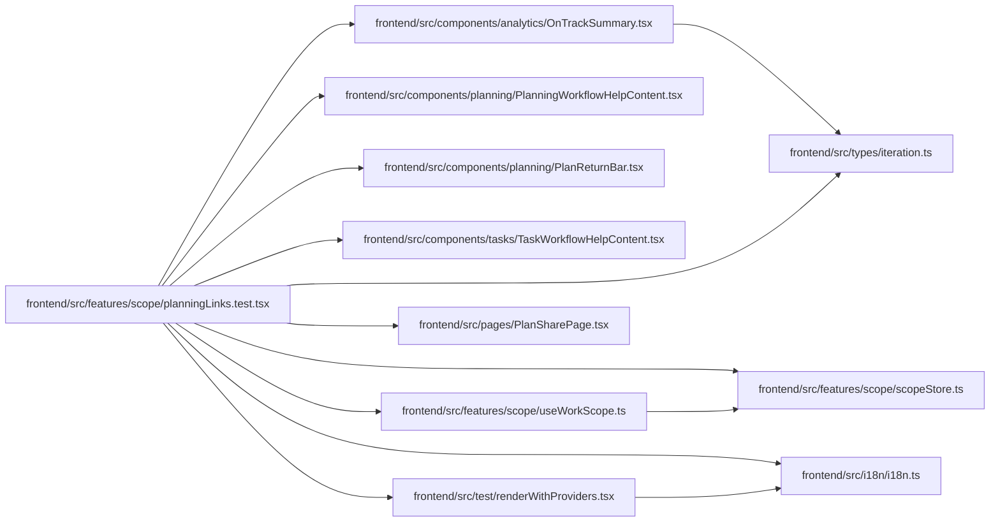

# planningLinks.test Module

**Path:** `frontend/src/features/scope/planningLinks.test.tsx`

## Description

_Auto-generated from `frontend/src/features/scope/planningLinks.test.tsx`._

## Imports

| Source | Symbols | Type-only | Runtime emission |
|--------|---------|-----------|------------------|
| `../../components/analytics/OnTrackSummary` | `OnTrackSummary` | — | compiler-dependent |
| `../../components/planning/PlanReturnBar` | `PlanReturnBar` | — | compiler-dependent |
| `../../components/planning/PlanningWorkflowHelpContent` | `PlanningWorkflowHelpContent` | — | compiler-dependent |
| `../../components/tasks/TaskWorkflowHelpContent` | `TaskWorkflowHelpContent` | — | compiler-dependent |
| `../../i18n/i18n` | `i18n` | — | compiler-dependent |
| `../../pages/PlanSharePage` | `PlanSharePage` | — | compiler-dependent |
| `../../test/renderWithProviders` | `createTestQueryClient`, `renderWithProviders` | — | compiler-dependent |
| `../../types/iteration` | `IterationSummary` | Declaration | erased |
| `./scopeStore` | `useScopeStore` | — | compiler-dependent |
| `./useWorkScope` | `useWorkScope` | — | compiler-dependent |
| `@tanstack/react-query` | `QueryClientProvider` | — | compiler-dependent |
| `@testing-library/react` | `act`, `render`, `screen`, `waitFor` | — | compiler-dependent |
| `react-router-dom` | `createMemoryRouter`, `Outlet`, `Route`, `RouterProvider`, `Routes`, `useLocation` | — | compiler-dependent |
| `vitest` | `afterEach`, `beforeEach`, `describe`, `expect`, `it`, `vi` | — | compiler-dependent |

## Module Signals

| Signal | Values |
|--------|--------|
| Constants | `iterationServiceMock`, `planShareServiceMock`, `ITERATIONS` |
| Module calls | `iterationServiceMock = hoisted`, `planShareServiceMock = hoisted`, `mock`, `mock`, `mock`, `beforeEach`, `afterEach`, `describe`, `describe` |

## Local dependency map

<!-- Auto-generated local dependency summary. Do not edit by hand. -->
This graph shows full source coupling. Type dependencies can be erased; compiler-dependent cycle groups are runtime candidates, not confirmed initialization cycles.

### Internal neighbors

| Direction | Module |
|---|---|
| Outbound | [OnTrackSummary](../modules/OnTrackSummary.md) |
| Outbound | [PlanningWorkflowHelpContent](../modules/PlanningWorkflowHelpContent.md) |
| Outbound | [PlanReturnBar](../modules/PlanReturnBar.md) |
| Outbound | [TaskWorkflowHelpContent](../modules/TaskWorkflowHelpContent.md) |
| Outbound | [scopeStore](../modules/scopeStore.md) |
| Outbound | [useWorkScope](../modules/useWorkScope.md) |
| Outbound | [i18n](../modules/i18n.md) |
| Outbound | [PlanSharePage](../modules/PlanSharePage.md) |
| Outbound | [renderWithProviders](../modules/renderWithProviders.md) |
| Outbound | [types_iteration](../modules/types_iteration.md) |

### External packages

| Language | Used packages | Undeclared packages |
|---|---:|---:|
| typescript | 4 | 0 |
