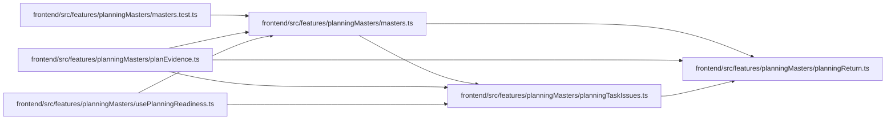

# masters Module

**Path:** `frontend/src/features/planningMasters/masters.ts`

## Description

_Auto-generated from `frontend/src/features/planningMasters/masters.ts`._

## Imports

| Source | Symbols | Type-only | Runtime emission |
|--------|---------|-----------|------------------|
| `./planningReturn` | `PlanningStepId` | Declaration | erased |
| `./planningTaskIssues` | `PlanningTaskIssue` | Declaration | erased |

## Module Signals

| Signal | Values |
|--------|--------|
| Exports | `PlanReadiness`, `derivePlanningRecovery` |

## Local dependency map

<!-- Auto-generated local dependency summary. Do not edit by hand. -->
This graph shows full source coupling. Type dependencies can be erased; compiler-dependent cycle groups are runtime candidates, not confirmed initialization cycles.

### Internal neighbors

| Direction | Module |
|---|---|
| Inbound | [planningMasters_masters.test](../modules/planningMasters_masters.test.md) |
| Inbound | [planEvidence](../modules/planEvidence.md) |
| Inbound | [usePlanningReadiness](../modules/usePlanningReadiness.md) |
| Outbound | [planningReturn](../modules/planningReturn.md) |
| Outbound | [planningTaskIssues](../modules/planningTaskIssues.md) |

## Classes

| Class | Kind | Line | Bases / Target | Description |
|-------|------|------|----------------|-------------|
| [PlanReadiness](../entities/PlanReadiness.md) | Interface | 8 | — | — |
| [PlanningRecoveryAction](../entities/PlanningRecoveryAction.md) | Interface | 41 | — | — |
| [PlanningRecoveryKind](../entities/PlanningRecoveryKind.md) | Type alias | 31 | <pre><code>&#124; &#39;create&#45;period&#39;&#10;    &#124; &#39;add&#45;team&#39;&#10;    &#124; &#39;repair&#45;capacity&#39;&#10;    &#124; &#39;add&#45;work&#39;&#10;    &#124; &#39;repair&#45;assignee&#39;&#10;    &#124; &#39;repair&#45;effort&#39;&#10;    &#124; &#39;build&#45;schedule&#39;&#10;    &#124; &#39;review&#45;plan&#39;</code></pre> | — |

## Functions

| Function | Signature | Decorators | Description |
|----------|-----------|------------|-------------|
| `derivePlanningRecovery` | `(selectedStepId: PlanningStepId, r: PlanReadiness) -> PlanningRecoveryAction` | — | Resolve the single workspace action owned by a selected checkpoint. |
