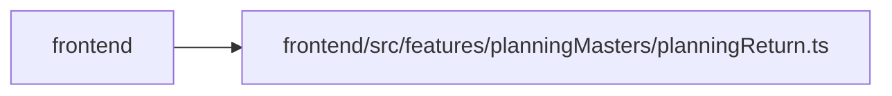

# planningReturn Module

**Path:** `frontend/src/features/planningMasters/planningReturn.ts`

## Description

_Auto-generated from `frontend/src/features/planningMasters/planningReturn.ts`._

## Module Signals

| Signal | Values |
|--------|--------|
| Exports | `PLANNING_RETURN_STEP_PARAM`, `PLANNING_STEP_IDS`, `PLAN_RETURNED_PARAM`, `PlanningStepId`, `isPlanningStepId`, `planStepHref`, `withPlanReturn` |
| Constants | `PLANNING_RETURN_STEP_PARAM`, `PLANNING_STEP_IDS`, `PLAN_RETURNED_PARAM` |

## Local dependency map

<!-- Auto-generated local dependency summary. Do not edit by hand. -->
This graph shows full source coupling. Type dependencies can be erased; compiler-dependent cycle groups are runtime candidates, not confirmed initialization cycles.

> Module-level dependencies exceed the generated-diagram limits, so the diagram and table below group them by top-level package. Counts report the number of module neighbors in each package.

### Internal neighbors

| Direction | Module |
|---|---|
| Inbound | `frontend` (17) |

> All 17 module neighbor(s) are summarized by package because the module-level view exceeds the 12-node limit.

## Classes

| Class | Kind | Line | Bases / Target | Description |
|-------|------|------|----------------|-------------|
| [PlanningStepId](../entities/PlanningStepId.md) | Type alias | 12 | `typeof PLANNING_STEP_IDS[number]` | — |

## Functions

| Function | Signature | Decorators | Description |
|----------|-----------|------------|-------------|
| `isPlanningStepId` | `(value: string \| null) -> value is PlanningStepId` | — | — |
| `planStepHref` | `(stepId: PlanningStepId, { returned = false }: { returned?: boolean } = {})` | — | Link back to a plan section; `returned` re-reads readiness and opens the next section when this one is done. |
| `withPlanReturn` | `(route: string, returnStepId: PlanningStepId, options: Record<string, string> = {})` | — | — |
