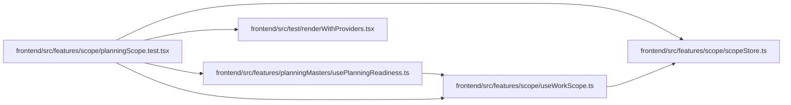

# planningScope.test Module

**Path:** `frontend/src/features/scope/planningScope.test.tsx`

## Description

_Auto-generated from `frontend/src/features/scope/planningScope.test.tsx`._

## Imports

| Source | Symbols | Type-only | Runtime emission |
|--------|---------|-----------|------------------|
| `../../test/renderWithProviders` | `createTestQueryClient` | — | compiler-dependent |
| `../planningMasters/usePlanningReadiness` | `usePlanningReadiness` | — | compiler-dependent |
| `./scopeStore` | `useScopeStore` | — | compiler-dependent |
| `./useWorkScope` | `useWorkScope` | — | compiler-dependent |
| `@tanstack/react-query` | `QueryClientProvider` | — | compiler-dependent |
| `@testing-library/react` | `act`, `render`, `screen`, `waitFor` | — | compiler-dependent |
| `@testing-library/user-event` | `userEvent` | — | compiler-dependent |
| `react` | `ReactNode` | Specifier | compiler-dependent |
| `react` | `useState` | — | compiler-dependent |
| `react-router-dom` | `createMemoryRouter`, `Outlet`, `RouterProvider`, `useLocation` | — | compiler-dependent |
| `vitest` | `afterEach`, `beforeEach`, `describe`, `expect`, `it`, `vi` | — | compiler-dependent |

## Module Signals

| Signal | Values |
|--------|--------|
| Constants | `serviceMocks`, `ITERATIONS` |
| Module calls | `serviceMocks = hoisted`, `mock`, `mock`, `mock`, `mock`, `mock`, `describe` |

## Local dependency map

<!-- Auto-generated local dependency summary. Do not edit by hand. -->

### Internal neighbors

| Direction | Module |
|---|---|
| Outbound | [usePlanningReadiness](../modules/usePlanningReadiness.md) |
| Outbound | [scopeStore](../modules/scopeStore.md) |
| Outbound | [useWorkScope](../modules/useWorkScope.md) |
| Outbound | [renderWithProviders](../modules/renderWithProviders.md) |

### External packages

| Language | Used packages | Undeclared packages |
|---|---:|---:|
| typescript | 6 | 0 |
