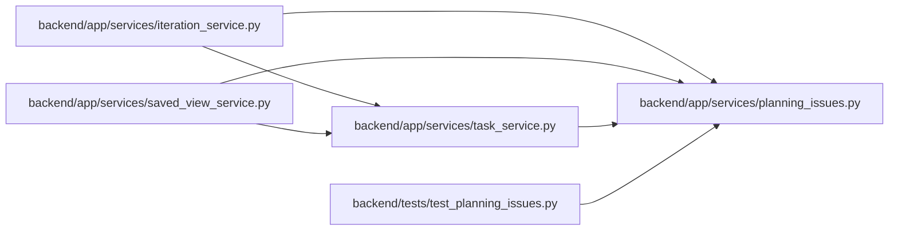

# planning_issues Module

**Path:** `backend/app/services/planning_issues.py`

## Description

One rule for the planning gaps people and the PM see: "needs an assignee" and "missing effort".

The scheduler places only planned leaf work, so a task is a scheduling gap only
while it is planned, a leaf, and not deferred. A task an agent is already
working on is "Agent working · no capacity row", not unassigned.

## Imports

| Source | Symbols |
|--------|---------|
| `__future__` | `annotations` |
| `math` | `isfinite` |
| `typing` | `Any` |

## Local dependency map

<!-- Auto-generated local dependency summary. Do not edit by hand. -->

### Internal neighbors

| Direction | Module |
|---|---|
| Inbound | [iteration_service](../modules/iteration_service.md) |
| Inbound | [saved_view_service](../modules/saved_view_service.md) |
| Inbound | [task_service](../modules/task_service.md) |
| Inbound | [test_planning_issues](../modules/test_planning_issues.md) |

## Functions

| Function | Signature | Decorators | Description |
|----------|-----------|------------|-------------|
| `is_planning_gap_candidate` | `(task: Any) -> bool` | — | A planned, non-deferred leaf: the only work the scheduler places. |
| `_agent_working` | `(task: Any) -> bool` | — | Whether an agent holds live execution work: a response's ``agent_working`` field, |
| `needs_assignee` | `(task: Any) -> bool` | — | — |
| `agent_working_without_capacity` | `(task: Any) -> bool` | — | — |
| `missing_effort` | `(task: Any) -> bool` | — | — |
