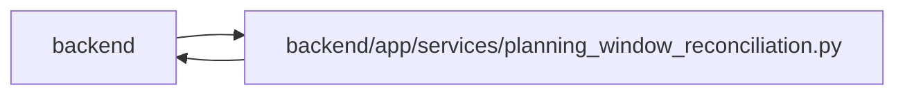

# planning_window_reconciliation Module

**Path:** `backend/app/services/planning_window_reconciliation.py`

## Description

Reconcile existing ownership only from an authenticated date-only command and its preimage.

An operator can recover existing ownership when the original PM command, authenticated owner receipt and server snapshot prove a single date-only reservation. Preview identifies the assignment and evidence digest. Applying the same digest and command key records one attributable result. A repeated read can reuse verified projection digests only when the current snapshot bytes match; an owning command validates the canonical source again.

## Imports

| Source | Symbols |
|--------|---------|
| `app.authority` | `AuthorityError`, `require_operator` |
| `app.commands` | `command_transaction` |
| `app.config` | `get_settings` |
| `app.models.agent` | `AgentIdempotencyRecord`, `TaskEvent` |
| `app.models.identity` | `CommandAudit`, `Principal` |
| `app.models.iteration` | `Iteration` |
| `app.models.recovery` | `ApplicationSnapshot` |
| `app.models.task` | `Task` |
| `app.schemas.agent_planning` | `AgentPlanningCommandContext`, `AgentPlanningReceipt` |
| `app.services` | `execution_planning_window` |
| `app.services.agent_model_catalog_service` | `AgentModelConflictError` |
| `app.services.agent_planning_service` | `AgentPlanningService` |
| `app.services.agent_service` | `actor_has_scope`, `is_admin_key_principal`, `validate_idempotency_key` |
| `app.services.execution_planning_window` | `digest`, `live_assignments`, `make_window`, `original_ownership` |
| `app.services.snapshot_service` | `SnapshotService` |
| `app.services.task_service` | `TaskService` |
| `collections` | `OrderedDict` |
| `contextlib` | `nullcontext` |
| `dataclasses` | `dataclass` |
| `datetime` | `date`, `datetime` |
| `hashlib` | `hashlib` |
| `json` | `json` |
| `re` | `re` |
| `secrets` | `secrets` |
| `sqlalchemy` | `Text`, `cast`, `func`, `literal`, `literal_column`, `select`, `update` |
| `threading` | `Lock` |

## Local dependency map

<!-- Auto-generated local dependency summary. Do not edit by hand. -->

> Module-level dependencies exceed the generated-diagram limits, so the diagram and table below group them by top-level package. Counts report the number of module neighbors in each package.

### Internal neighbors

| Direction | Module |
|---|---|
| Inbound | `backend` (5) |
| Outbound | `backend` (15) |

### External packages

| Language | Used packages | Undeclared packages |
|---|---:|---:|
| python | 1 | 0 |

> All 20 module neighbor(s) are summarized by package because the module-level view exceeds the 12-node limit.

## Classes

| Class | Line | Bases | Description |
|-------|------|-------|-------------|
| [SnapshotIdentity](../entities/SnapshotIdentity.md) | 40 | — | — |
| [_SavedTask](../entities/SavedTask.md) | 49 | — | — |

## Functions

| Function | Signature | Decorators | Description |
|----------|-----------|------------|-------------|
| `_cached_task` | `(key, task_id)` | — | — |
| `_remember_task` | `(key, task_id, view)` | — | — |
| `_canonical_snapshot_checksum` | `(payload)` | — | — |
| `_snapshot_task` | `(snapshot, task_id, expected_version, expected_context, expected_scope, next_end, *, cache_reads, source_text = None)` | — | — |
| `source_receipt_id` | *(async)* `(db, operation, target_type, target_id, *, receipt_id, actor_id, command_key)` | — | Resolve an exact ordinary PM receipt using identifiers returned by its public command. |
| `_saved_tasks` | `(roots, task_id)` | — | — |
| `_planning_proof` | *(async)* `(db, task, receipt_id, *, after_recovery = False, cache_reads = False, lock = False)` | — | — |
| `reconcile_window` | *(async)* `(db, actor, task_id, receipt_id = None, *, planning_actor_id = None, planning_command_key = None, apply = False, expected_evidence_digest = None, idempotency_key = None, rationale = None, correlation_id = None)` | — | — |