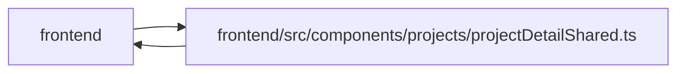

# projectDetailShared Module

**Path:** `frontend/src/components/projects/projectDetailShared.ts`

## Description

_Auto-generated from `frontend/src/components/projects/projectDetailShared.ts`._

## Imports

| Source | Symbols | Type-only | Runtime emission |
|--------|---------|-----------|------------------|
| `../../i18n/i18n` | `i18n` | — | compiler-dependent |
| `../../types/project` | `ProjectHealth`, `ProjectMilestone`, `ProjectMilestoneCreateRequest`, `ProjectMilestoneStatus`, `ProjectMilestoneUpdateRequest`, `ProjectStatus`, `ProjectTargetDateRisk`, `ProjectUpdateEntry`, `ProjectUpdateFreshness` | Declaration | erased |
| `../../types/release` | `ReleaseStatus` | Declaration | erased |
| `../../utils/workNumbers` | `formatDecimal` | — | compiler-dependent |

## Module Signals

| Signal | Values |
|--------|--------|
| Exports | `MilestoneEditorState`, `MilestoneFormState`, `ProjectUpdateErrorStore`, `ProjectUpdateFormState`, `ProjectUpdateFormStore`, `buildMilestonePayload`, `createEmptyMilestoneForm`, `createEmptyUpdateForm`, `createMilestoneFormFromRecord`, `formatNumber`, `formatUpdateAge`, `healthDotClass`, `healthLabelKeys`, `healthToTone`, `milestoneStatusLabelKeys`, `nullableTrimmedText`, `projectStatusLabelKeys`, `releaseBadgeClassName`, `releaseStatusLabelKeys`, `riskLabelKeys`, `riskTone`, `t`, `textareaClassName`, `toDateInputValue`, `toDateTimeInputValue`, `updateDetailFields`, `updateFreshnessLabelKeys`, `updateFreshnessMessage` |
| Constants | `t`, `projectStatusLabelKeys`, `milestoneStatusLabelKeys`, `healthLabelKeys`, `riskLabelKeys`, `updateFreshnessLabelKeys`, `releaseStatusLabelKeys`, `textareaClassName` |
| Module calls | `t = bind` |

## Local dependency map

<!-- Auto-generated local dependency summary. Do not edit by hand. -->
This graph shows full source coupling. Type dependencies can be erased; compiler-dependent cycle groups are runtime candidates, not confirmed initialization cycles.

> Module-level dependencies exceed the generated-diagram limits, so the diagram and table below group them by top-level package. Counts report the number of module neighbors in each package.

### Internal neighbors

| Direction | Module |
|---|---|
| Inbound | `frontend` (8) |
| Outbound | `frontend` (4) |

> All 12 module neighbor(s) are summarized by package because the module-level view exceeds the 12-node limit.

## Classes

| Class | Kind | Line | Bases / Target | Description |
|-------|------|------|----------------|-------------|
| [ProjectUpdateFormState](../entities/ProjectUpdateFormState.md) | Type alias | 92 | <pre><code>&#123;&#10;    health&#58; ProjectHealth&#59;&#10;    summary&#58; string&#59;&#10;    progress&#95;text&#58; string&#59;&#10;    risks&#95;text&#58; string&#59;&#10;    decisions&#95;text&#58; string&#59;&#10;    next&#95;steps&#95;text&#58; string&#59;&#10;&#125;</code></pre> | — |
| [ProjectUpdateFormStore](../entities/ProjectUpdateFormStore.md) | Type alias | 101 | <pre><code>&#123;&#10;    projectId&#58; number &#124; null&#59;&#10;    form&#58; ProjectUpdateFormState&#59;&#10;&#125;</code></pre> | — |
| [ProjectUpdateErrorStore](../entities/ProjectUpdateErrorStore.md) | Type alias | 106 | <pre><code>&#123;&#10;    projectId&#58; number &#124; null&#59;&#10;    message&#58; string &#124; null&#59;&#10;&#125;</code></pre> | — |
| [MilestoneFormState](../entities/MilestoneFormState.md) | Type alias | 111 | <pre><code>&#123;&#10;    name&#58; string&#59;&#10;    description&#58; string&#59;&#10;    target&#95;date&#58; string&#59;&#10;    completed&#95;at&#58; string&#59;&#10;    sort&#95;order&#58; string&#59;&#10;    status&#58; ProjectMilestoneStatus&#59;&#10;&#125;</code></pre> | — |
| [MilestoneEditorState](../entities/MilestoneEditorState.md) | Type alias | 120 | <pre><code>&#123;&#10;    mode&#58; &#39;create&#39; &#124; &#39;edit&#39;&#59;&#10;    milestone&#58; ProjectMilestone &#124; null&#59;&#10;    form&#58; MilestoneFormState&#59;&#10;    error&#58; string &#124; null&#59;&#10;&#125;</code></pre> | — |

## Functions

| Function | Signature | Decorators | Description |
|----------|-----------|------------|-------------|
| `releaseBadgeClassName` | `(status: ReleaseStatus \| string)` | — | — |
| `riskTone` | `(risk?: string) -> 'gray' \| 'green' \| 'yellow' \| 'red'` | — | — |
| `formatNumber` | `(value?: number)` | — | — |
| `createEmptyUpdateForm` | `(health: ProjectHealth) -> ProjectUpdateFormState` | — | — |
| `nullableTrimmedText` | `(value: string)` | — | — |
| `toDateInputValue` | `(value?: string \| null)` | — | — |
| `toDateTimeInputValue` | `(value?: string \| null)` | — | — |
| `createEmptyMilestoneForm` | `(sortOrder = 0) -> MilestoneFormState` | — | — |
| `createMilestoneFormFromRecord` | `(milestone: ProjectMilestone) -> MilestoneFormState` | — | — |
| `buildMilestonePayload` | `(form: MilestoneFormState) -> ProjectMilestoneCreateRequest \| ProjectMilestoneUpdateRequest` | — | — |
| `formatUpdateAge` | `(days?: number \| null)` | — | — |
| `updateDetailFields` | `(update: ProjectUpdateEntry)` | — | — |
| `updateFreshnessMessage` | `(freshness: ProjectUpdateFreshness, daysSinceLatestUpdate?: number \| null, thresholdDays = 7)` | — | — |
| `healthToTone` | `(health: ProjectHealth) -> 'gray' \| 'green' \| 'yellow' \| 'red'` | — | — |
| `healthDotClass` | `(health: ProjectHealth)` | — | — |
