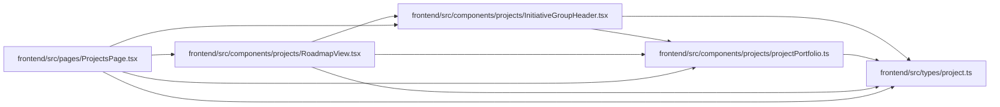

# projectPortfolio Module

**Path:** `frontend/src/components/projects/projectPortfolio.ts`

## Description

_Auto-generated from `frontend/src/components/projects/projectPortfolio.ts`._

## Imports

| Source | Symbols | Type-only | Runtime emission |
|--------|---------|-----------|------------------|
| `../../types/project` | `Initiative`, `Project`, `ProjectHealth`, `ProjectStatus` | Declaration | erased |
| `date-fns` | `compareAsc`, `parseISO` | — | compiler-dependent |

## Module Signals

| Signal | Values |
|--------|--------|
| Exports | `HEALTH_NEEDS_ATTENTION`, `InitiativeGroup`, `InitiativeGroupInfo`, `NONE_VALUE`, `PORTFOLIO_PARAMS`, `PROJECT_HEALTHS`, `PROJECT_STATUSES`, `PortfolioFilters`, `PortfolioView`, `compareInitiatives`, `groupByInitiative`, `hasActiveFilters`, `matchesPortfolioFilters`, `ownerKeyForProject`, `readPortfolioFilters`, `readPortfolioView`, `readSavedViewId`, `readTimelineWindow` |
| Constants | `PORTFOLIO_PARAMS`, `NONE_VALUE`, `HEALTH_NEEDS_ATTENTION`, `PROJECT_STATUSES`, `PROJECT_HEALTHS`, `isoDate` |

## Local dependency map

<!-- Auto-generated local dependency summary. Do not edit by hand. -->
This graph shows full source coupling. Type dependencies can be erased; compiler-dependent cycle groups are runtime candidates, not confirmed initialization cycles.

### Internal neighbors

| Direction | Module |
|---|---|
| Inbound | [InitiativeGroupHeader](../modules/InitiativeGroupHeader.md) |
| Inbound | [RoadmapView](../modules/RoadmapView.md) |
| Inbound | [ProjectsPage](../modules/ProjectsPage.md) |
| Outbound | [types_project](../modules/types_project.md) |

### External packages

| Language | Used packages | Undeclared packages |
|---|---:|---:|
| typescript | 1 | 0 |

## Classes

| Class | Kind | Line | Bases / Target | Description |
|-------|------|------|----------------|-------------|
| [PortfolioView](../entities/PortfolioView.md) | Type alias | 5 | `'list' \| 'roadmap'` | The two views of the portfolio. |
| [PortfolioFilters](../entities/PortfolioFilters.md) | Type alias | 11 | <pre><code>&#123;&#10;    search&#58; string&#59;&#10;    status&#58; ProjectStatus &#124; &#39;&#39;&#59;&#10;    health&#58; ProjectHealth &#124; &#39;&#39;&#59;&#10;    &#47;&#42;&#42; &#96;profile&#58;&#60;id&#62;&#96;&#44; &#96;member&#58;&#60;id&#62;&#96; or &#96;none&#96;&#46; &#42;&#47;&#10;    owner&#58; string&#59;&#10;    &#47;&#42;&#42; An initiative id or &#96;none&#96;&#46; &#42;&#47;&#10;    initiative&#58; string&#59;&#10;    &#47;&#42;&#42;&#10;     &#42; Set by the at&#45;risk count&#58; at risk or off track&#46; The Health filter shows it&#10;     &#42; as its &#34;At risk or off track&#34; option&#44; so it is never set together with &#96;health&#96;&#46;&#10;     &#42;&#47;&#10;    attention&#58; &#39;at&#95;risk&#39; &#124; &#39;&#39;&#59;&#10;&#125;</code></pre> | Everything that narrows the portfolio, as it is kept in the address bar. |
| [InitiativeGroupInfo](../entities/InitiativeGroupInfo.md) | Type alias | 108 | <pre><code>Pick&#60;&#10;    Initiative&#44;&#10;    &#39;id&#39; &#124; &#39;name&#39; &#124; &#39;owner&#95;id&#39; &#124; &#39;owner&#39; &#124; &#39;owner&#95;profile&#95;id&#39; &#124; &#39;owner&#95;profile&#39; &#124; &#39;health&#39; &#124; &#39;target&#95;date&#39;&#10;&#62; &#38; Partial&#60;Pick&#60;Initiative&#44; &#39;description&#39;&#62;&#62;</code></pre> | — |
| [InitiativeGroup](../entities/InitiativeGroup.md) | Type alias | 113 | <pre><code>&#123;&#10;    key&#58; string&#59;&#10;    &#47;&#42;&#42; Null for the projects that belong to no initiative&#46; &#42;&#47;&#10;    initiative&#58; InitiativeGroupInfo &#124; null&#59;&#10;    items&#58; T&#91;&#93;&#59;&#10;&#125;</code></pre> | — |

## Functions

| Function | Signature | Decorators | Description |
|----------|-----------|------------|-------------|
| `readPortfolioView` | `(params: URLSearchParams) -> PortfolioView` | — | The view named in the address; a saved-view id or anything else shows the list. |
| `readSavedViewId` | `(params: URLSearchParams) -> number \| null` | — | A numeric `view` value opens a saved view, as links from the command menu do. |
| `readPortfolioFilters` | `(params: URLSearchParams) -> PortfolioFilters` | — | — |
| `readTimelineWindow` | `(params: URLSearchParams)` | — | The timeline window set by a preset; empty when the timeline fits its projects. |
| `hasActiveFilters` | `(filters: PortfolioFilters)` | — | — |
| `ownerKeyForProject` | `(project: Pick<Project, 'owner_profile_id' \| 'owner_id'>)` | — | — |
| `matchesPortfolioFilters` | `(project: Project, filters: PortfolioFilters)` | — | — |
| `compareInitiatives` | `(a: InitiativeGroupInfo, b: InitiativeGroupInfo)` | — | Earliest target date first, undated initiatives after, then by name. |
| `groupByInitiative` | `<T>(items: T[], projectOf: (item: T) => Project, initiatives: Initiative[], includeEmpty: boolean) -> InitiativeGroup<T>[]` | — | Puts each item under its project's initiative, keeping the items' order inside |
