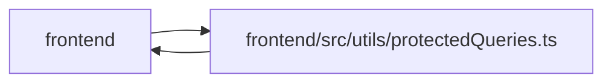

# protectedQueries Module

**Path:** `frontend/src/utils/protectedQueries.ts`

## Description

_Auto-generated from `frontend/src/utils/protectedQueries.ts`._

## Imports

| Source | Symbols | Type-only | Runtime emission |
|--------|---------|-----------|------------------|
| `./apiError` | `getApiErrorStatus` | — | compiler-dependent |

## Module Signals

| Signal | Values |
|--------|--------|
| Exports | `protectedQueryRetry` |

## Local dependency map

<!-- Auto-generated local dependency summary. Do not edit by hand. -->

> Module-level dependencies exceed the generated-diagram limits, so the diagram and table below group them by top-level package. Counts report the number of module neighbors in each package.

### Internal neighbors

| Direction | Module |
|---|---|
| Inbound | `frontend` (11) |
| Outbound | `frontend` (1) |

> All 12 module neighbor(s) are summarized by package because the module-level view exceeds the 12-node limit.

## Functions

| Function | Signature | Decorators | Description |
|----------|-----------|------------|-------------|
| `protectedQueryRetry` | `(failureCount: number, error: unknown)` | — | — |
