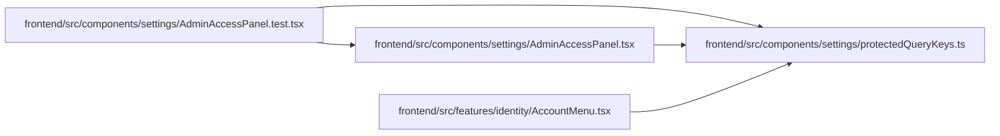

# protectedQueryKeys Module

**Path:** `frontend/src/components/settings/protectedQueryKeys.ts`

## Description

/** Query keys whose data needs the admin key: they are dropped on unlock and lock, and refetched after an unlock. */

## Module Signals

| Signal | Values |
|--------|--------|
| Exports | `protectedQueryKeys` |
| Constants | `protectedQueryKeys` |

## Local dependency map

<!-- Auto-generated local dependency summary. Do not edit by hand. -->

### Internal neighbors

| Direction | Module |
|---|---|
| Inbound | [AdminAccessPanel.test](../modules/AdminAccessPanel.test.md) |
| Inbound | [AdminAccessPanel](../modules/AdminAccessPanel.md) |
| Inbound | [AccountMenu](../modules/AccountMenu.md) |
