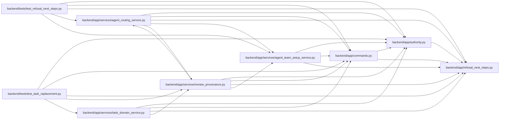

# refusal_next_steps Module

**Path:** `backend/app/refusal_next_steps.py`

## Description

The legal next step for every verification and review refusal, kept in one place.

A refusal names what went wrong; its ``next_step`` names what a person or agent may do
about it. Every REST envelope, MCP tool error and task action blocker takes its next step
from this catalogue, so the three never drift apart. A code with no entry here gets no
``next_step`` key, and a test fails when a refusal code in the source has no entry.

A code has one default step. A code that is raised for different causes also has named
variants, and the raise site that knows its cause picks the variant, so a step is never
offered where it would be refused. Each ``kind`` names exactly one sentence: the task page
translates the sentence by its kind.

## Imports

| Source | Symbols |
|--------|---------|
| `__future__` | `annotations` |
| `copy` | `deepcopy` |
| `typing` | `Any` |

## Local dependency map

<!-- Auto-generated local dependency summary. Do not edit by hand. -->

### Internal neighbors

| Direction | Module |
|---|---|
| Inbound | [authority](../modules/authority.md) |
| Inbound | [commands](../modules/commands.md) |
| Inbound | [agent_routing_service](../modules/agent_routing_service.md) |
| Inbound | [agent_team_setup_service](../modules/agent_team_setup_service.md) |
| Inbound | [review_provenance](../modules/review_provenance.md) |
| Inbound | [task_domain_service](../modules/task_domain_service.md) |
| Inbound | [test_refusal_next_steps](../modules/test_refusal_next_steps.md) |
| Inbound | [test_task_replacement](../modules/test_task_replacement.md) |

## Functions

| Function | Signature | Decorators | Description |
|----------|-----------|------------|-------------|
| `_step` | `(kind: str, authority: str, message: str, commands: dict[str, str] \| None = None, ui_action: str \| None = None)` | — | — |
| `_fill` | `(step: dict[str, Any], task_id: int \| None) -> dict[str, Any]` | — | — |
| `next_step_for` | `(code: str \| None, *, task_id: int \| None = None, variant: str \| None = None) -> dict[str, Any] \| None` | — | The machine-readable next step for a refusal code, or None when the code has none. |
| `with_next_step` | `(detail: dict[str, Any], *, task_id: int \| None = None) -> dict[str, Any]` | — | Add the code's next step to a refusal envelope that does not carry one yet. |
