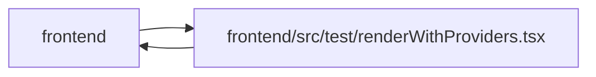

# renderWithProviders Module

**Path:** `frontend/src/test/renderWithProviders.tsx`

## Description

_Auto-generated from `frontend/src/test/renderWithProviders.tsx`._

## Imports

| Source | Symbols | Type-only | Runtime emission |
|--------|---------|-----------|------------------|
| `../components/feedback/ToastProvider` | `ToastProvider` | — | compiler-dependent |
| `../i18n/i18n` | — | — | present |
| `@tanstack/react-query` | `QueryClient`, `QueryClientProvider` | — | compiler-dependent |
| `@testing-library/react` | `RenderOptions` | Specifier | compiler-dependent |
| `@testing-library/react` | `render` | — | compiler-dependent |
| `@testing-library/user-event` | `userEvent` | — | compiler-dependent |
| `react` | `ReactElement`, `ReactNode` | Declaration | erased |
| `react-router-dom` | `MemoryRouter` | — | compiler-dependent |

## Module Signals

| Signal | Values |
|--------|--------|
| Exports | `createTestQueryClient`, `renderWithProviders` |

## Local dependency map

<!-- Auto-generated local dependency summary. Do not edit by hand. -->

> Module-level dependencies exceed the generated-diagram limits, so the diagram and table below group them by top-level package. Counts report the number of module neighbors in each package.

### Internal neighbors

| Direction | Module |
|---|---|
| Inbound | `frontend` (79) |
| Outbound | `frontend` (2) |

### External packages

| Language | Used packages | Undeclared packages |
|---|---:|---:|
| typescript | 5 | 0 |

> All 81 module neighbor(s) are summarized by package because the module-level view exceeds the 12-node limit.

## Classes

| Class | Kind | Line | Bases / Target | Description |
|-------|------|------|----------------|-------------|
| [RenderWithProvidersOptions](../entities/RenderWithProvidersOptions.md) | Interface | 20 | `Omit<RenderOptions, 'wrapper'>` | — |

## Functions

| Function | Signature | Decorators | Description |
|----------|-----------|------------|-------------|
| `createTestQueryClient` | `()` | — | — |
| `renderWithProviders` | <pre><code>&#40;ui&#58; ReactElement&#44; &#123;&#10;        initialEntries &#61; &#91;&#39;&#47;&#39;&#93;&#44;&#10;        queryClient &#61; createTestQueryClient&#40;&#41;&#44;&#10;        &#46;&#46;&#46;renderOptions&#10;    &#125;&#58; RenderWithProvidersOptions &#61; &#123;&#125;&#41;</code></pre> | — | — |
