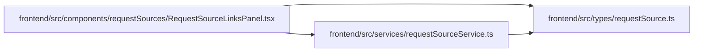

# requestSource Module

**Path:** `frontend/src/types/requestSource.ts`

## Description

_Auto-generated from `frontend/src/types/requestSource.ts`._

## Module Signals

| Signal | Values |
|--------|--------|
| Exports | `RequestSource`, `RequestSourceCreate`, `RequestSourceLink`, `RequestSourceLinkCreate`, `RequestSourceLinkWithSource`, `RequestSourceTargetType`, `RequestSourceType` |

## Local dependency map

<!-- Auto-generated local dependency summary. Do not edit by hand. -->
This graph shows full source coupling. Type dependencies can be erased; compiler-dependent cycle groups are runtime candidates, not confirmed initialization cycles.

### Internal neighbors

| Direction | Module |
|---|---|
| Inbound | [RequestSourceLinksPanel](../modules/RequestSourceLinksPanel.md) |
| Inbound | [requestSourceService](../modules/requestSourceService.md) |

## Classes

| Class | Kind | Line | Bases / Target | Description |
|-------|------|------|----------------|-------------|
| [RequestSource](../entities/requestSource_RequestSource.md) | Interface | 4 | — | — |
| [RequestSourceCreate](../entities/requestSource_RequestSourceCreate.md) | Interface | 16 | — | — |
| [RequestSourceLink](../entities/requestSource_RequestSourceLink.md) | Interface | 26 | — | — |
| [RequestSourceLinkWithSource](../entities/RequestSourceLinkWithSource.md) | Interface | 35 | `RequestSourceLink` | — |
| [RequestSourceType](../entities/requestSource_RequestSourceType.md) | Type alias | 1 | `'customer' \| 'internal' \| 'support' \| 'email' \| 'web' \| 'import'` | — |
| [RequestSourceTargetType](../entities/requestSource_RequestSourceTargetType.md) | Type alias | 2 | `'task' \| 'project' \| 'triage_item'` | — |
| [RequestSourceLinkCreate](../entities/requestSource_RequestSourceLinkCreate.md) | Type alias | 39 | <pre><code>&#124; &#123;&#10;        target&#95;type&#58; RequestSourceTargetType&#59;&#10;        target&#95;id&#58; number&#59;&#10;        request&#95;source&#95;id&#58; number&#59;&#10;        request&#95;source&#63;&#58; never&#59;&#10;    &#125;&#10;    &#124; &#123;&#10;        target&#95;type&#58; RequestSourceTargetType&#59;&#10;        target&#95;id&#58; number&#59;&#10;        request&#95;source&#58; RequestSourceCreate&#59;&#10;        request&#95;source&#95;id&#63;&#58; never&#59;&#10;    &#125;</code></pre> | — |
