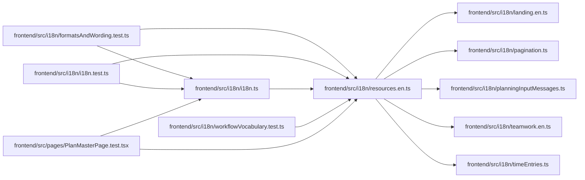

# resources.en Module

**Path:** `frontend/src/i18n/resources.en.ts`

## Description

_Auto-generated from `frontend/src/i18n/resources.en.ts`._

## Imports

| Source | Symbols | Type-only | Runtime emission |
|--------|---------|-----------|------------------|
| `./landing.en` | `landingEnglish` | — | compiler-dependent |
| `./pagination` | `paginationEN` | — | compiler-dependent |
| `./planningInputMessages` | `planningInputEnglish` | — | compiler-dependent |
| `./teamwork.en` | `teamworkEnglish` | — | compiler-dependent |
| `./timeEntries` | `timeEntriesEN` | — | compiler-dependent |

## Module Signals

| Signal | Values |
|--------|--------|
| Exports | `englishResources` |
| Constants | `englishResources` |

## Local dependency map

<!-- Auto-generated local dependency summary. Do not edit by hand. -->

### Internal neighbors

| Direction | Module |
|---|---|
| Inbound | [formatsAndWording.test](../modules/formatsAndWording.test.md) |
| Inbound | [i18n.test](../modules/i18n.test.md) |
| Inbound | [i18n](../modules/i18n.md) |
| Inbound | [workflowVocabulary.test](../modules/workflowVocabulary.test.md) |
| Inbound | [PlanMasterPage.test](../modules/PlanMasterPage.test.md) |
| Outbound | [landing.en](../modules/landing.en.md) |
| Outbound | [pagination](../modules/pagination.md) |
| Outbound | [planningInputMessages](../modules/planningInputMessages.md) |
| Outbound | [teamwork.en](../modules/teamwork.en.md) |
| Outbound | [timeEntries](../modules/timeEntries.md) |
