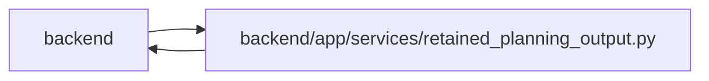

# retained_planning_output Module

**Path:** `backend/app/services/retained_planning_output.py`

## Description

Attribute an interrupted, checkpointed output without altering its historical lease or terminal result.

After an actual lease expiry and PM recovery, the original worker can identify the final output that it recorded while its old claim was live. The queue identifies an eligible checkpoint before the next generation begins. The original worker’s current attestation links that checkpoint, commit and model to the prior run. Historical cancellation remains intact, and independent review accounts for the prior and replacement runs separately.

## Imports

| Source | Symbols |
|--------|---------|
| `__future__` | `annotations` |
| `app.authority` | `internal_authority` |
| `app.commands` | `command_transaction` |
| `app.models.agent` | `AgentActor`, `AgentIdempotencyRecord`, `AgentRun`, `AgentRunEvent`, `AgentTaskAssignment`, `TaskEvent` |
| `app.schemas.agent` | `AgentRecoveryRequeueResponse`, `AgentRetainedOutputAttestation`, `TaskEventCreate` |
| `app.services.agent_service` | `AgentConflictError`, `AgentPermissionError`, `AgentService`, `require_scope`, `validate_idempotency_key` |
| `app.services.agent_work_service` | `AgentWorkService` |
| `app.services.execution_planning_window` | `authority_stamp` |
| `app.services.execution_reconciliation` | `_json_value` |
| `app.services.planning_window_reconciliation` | `_planning_proof`, `source_receipt_id` |
| `app.services.review_provenance` | `actor_provenance`, `rework_binding_identity` |
| `app.utils.github_links` | `parse_github_url` |
| `app.utils.time` | `as_utc`, `utc_now` |
| `datetime` | `datetime` |
| `hashlib` | `hashlib` |
| `json` | `json` |
| `re` | `re` |
| `secrets` | `secrets` |
| `sqlalchemy` | `select` |
| `types` | `SimpleNamespace` |

## Local dependency map

<!-- Auto-generated local dependency summary. Do not edit by hand. -->

> Module-level dependencies exceed the generated-diagram limits, so the diagram and table below group them by top-level package. Counts report the number of module neighbors in each package.

### Internal neighbors

| Direction | Module |
|---|---|
| Inbound | `backend` (5) |
| Outbound | `backend` (12) |

### External packages

| Language | Used packages | Undeclared packages |
|---|---:|---:|
| python | 1 | 0 |

> All 15 module neighbor(s) are summarized by package because the module-level view exceeds the 12-node limit.

## Functions

| Function | Signature | Decorators | Description |
|----------|-----------|------------|-------------|
| `_unverified` | `(reason)` | — | — |
| `_authenticate_checkpoint` | *(async)* `(db, actor, run, task, data, before_version)` | — | — |
| `_require_original_private_fence` | `(data, event, checkpoint, fence)` | — | — |
| `_retained_witness` | *(async)* `(db, task, actor, assignments, run, data, *, lock)` | — | Verify the shared public facts before giving queue guidance or recording the owner's statement. |
| `attest_retained_output` | *(async)* `(db, actor, run_id, data: AgentRetainedOutputAttestation, *, idempotency_key)` | — | — |
| `recovery_attestation_hint` | *(async)* `(db, task, replacement, cache, *, lock = False)` | — | Identify only a still-usable original-worker statement that beginning this queue item would foreclose. |
| `retained_attestations` | *(async)* `(db, task_id, runs)` | — | Read exact paired worker receipts and server-owned events, once per review history. |