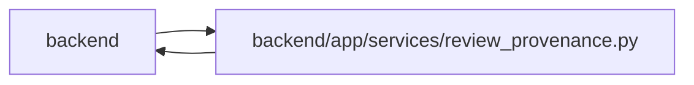

# review_provenance Module

**Path:** `backend/app/services/review_provenance.py`

## Description

Attribute task execution and bind independent review to its submitted candidate.

The review assignment binds the reviewer’s identity and model to a particular submission and artifact revision. The project can require a publisher distinct from every contributing publisher. An authenticated human executor can supply a manual candidate through the recorded start, resolution and current artifact. Agent execution history must be accounted for separately.

A supervised handback binds the rejection and its candidate to the latest worker submission. If the PM previously recovered the task, its issue receipt and event identify the original assignment version, and the worker submission identifies the later completed version. The begin transaction checks and locks the participating team members, project policy, assigned capacity and model identities. Earlier contributors remain part of the publisher check.

An evidence-backed verdict rechecks the packet against the current submission and execution history, including the contributing publishers and the reviewer's selected binding. The reviewer supplies the digest of the bytes it examined. The existing GitHub candidate check still verifies the submitted head for acceptance.

## Imports

| Source | Symbols |
|--------|---------|
| `__future__` | `annotations` |
| `app.authority` | `internal_authority` |
| `app.commands` | `current_command`, `current_command` |
| `app.models.agent` | `AgentActor`, `AgentIdempotencyRecord`, `AgentModelBinding`, `AgentModelCatalogEntry`, `AgentRun`, `AgentRunEvent`, `AgentTaskAssignment`, `AgentTeamTopology`, `AgentTeamTopologyMember`, `TaskEvent`, `AgentTaskAssignment` |
| `app.models.external_link` | `ExternalLink` |
| `app.models.identity` | `Principal` |
| `app.models.project` | `Project` |
| `app.models.task_brief` | `TaskProgressRecord` |
| `app.models.team_member` | `TeamMember`, `TeamMemberProfile` |
| `app.query_limits` | `CollectionLimitExceededError`, `MAX_BOUNDED_LIST_ITEMS` |
| `app.refusal_next_steps` | `next_step_for` |
| `app.schemas.agent` | `AgentReviewVerdictResponse`, `AgentWorkTerminalResponse`, `AgentRecoveryRequeueResponse` |
| `app.services.agent_routing_policy` | `ROUTING_DECISION_AUTHORITY`, `ROUTING_LINEAGE_AUTHORITY`, `canonical_routing_json_bytes` |
| `app.services.agent_routing_service` | `AgentRoutingConflictError`, `AgentRoutingService` |
| `app.services.agent_team_setup_service` | `AgentTeamSetupService` |
| `app.services.execution_planning_window` | `assignment_matches`, `candidate_version` |
| `app.services.github_status_service` | `GitHubStatusService` |
| `app.services.manual_provenance_service` | `recorded_provenances`, `submitted_candidate`, `remedy`, `remedy` |
| `app.services.retained_planning_output` | `retained_attestations` |
| `app.services.review_evidence` | `resolve` |
| `app.services.task_replacement_service` | `attributed`, `replacing`, `carried_contributors`, `attributed` |
| `app.utils.github_links` | `GitHubLinkError`, `parse_github_url` |
| `app.utils.url_policy` | `normalize_stored_display_url` |
| `dataclasses` | `dataclass`, `field` |
| `hashlib` | `hashlib` |
| `httpx` | `httpx` |
| `json` | `json` |
| `re` | `re` |
| `sqlalchemy` | `select` |
| `sqlalchemy.orm` | `contains_eager`, `selectinload` |
| `urllib.parse` | `urlsplit` |

## Local dependency map

<!-- Auto-generated local dependency summary. Do not edit by hand. -->

> Module-level dependencies exceed the generated-diagram limits, so the diagram and table below group them by top-level package. Counts report the number of module neighbors in each package.

### Internal neighbors

| Direction | Module |
|---|---|
| Inbound | `backend` (19) |
| Outbound | `backend` (22) |

### External packages

| Language | Used packages | Undeclared packages |
|---|---:|---:|
| python | 2 | 0 |

> All 35 module neighbor(s) are summarized by package because the module-level view exceeds the 12-node limit.

## Classes

| Class | Line | Bases | Description |
|-------|------|-------|-------------|
| [ReworkReadCache](../entities/ReworkReadCache.md) | 60 | — | Ephemeral evidence for one queue/context request or one locked begin transaction. |
| [ReviewHistory](../entities/ReviewHistory.md) | 677 | — | — |

## Functions

| Function | Signature | Decorators | Description |
|----------|-----------|------------|-------------|
| `_carries_unattributed_run` | `(rows)` | — | Whether replaced-task work with no recorded profile or publisher is carried, so an owner override cannot lift the hold. |
| `_conflict` | `(code, message, *, step = None, task_id = None, **details)` | — | Raise a routing conflict; ``step`` names the next step this cause allows, where the code has several. |
| `digest` | `(value)` | — | — |
| `rework_binding_identity` | `(provenance)` | — | Compare the complete operator binding captured at each authenticated boundary. |
| `_rework_verdict` | *(async)* `(db, task, assignment, sources, lineage)` | — | Find the unique immutable verifier receipt that issued this exact queued assignment. |
| `_rejected_execution` | *(async)* `(db, task, worker, sources, candidate)` | — | Cross-bind the selected candidate to its original worker's normal submit receipt. |
| `_supervised_recovery_origin` | *(async)* `(db, source, submit_receipt_id, manager_id, reviewer_profile_id)` | — | Authenticate the already selected PM recovery that produced the rejected submission. |
| `_lock_handback_team` | *(async)* `(db, worker_id, actor_ids)` | — | Fence the roster and its contributing members until an exact begin commits. |
| `supervised_rework_evidence` | *(async)* `(db, task, assignment, worker, lineage, *, lock = False, cache = None)` | — | Identify a strict shadow handback to the original actor, including previously issued rows. |
| `different_publisher_required` | *(async)* `(db, project_id, *, lock = False)` | — | — |
| `historical_profile` | `(assignment)` | — | Only an exact server-owned selection can supply a legacy assignment's profile. |
| `_begin_profile` | `(run)` | — | The authenticated begin receipt, or its audited reconciliation, names the run's own profile. |
| `_server_ended` | `(run)` | — | The server, not the worker's terminal command, ended this run. |
| `record_server_end_profile` | *(async)* `(db, run)` | — | When the server ends a run, record the actor's profile as the terminal command would. |
| `_run_profile_rows` | `(assignment_id, run, begun)` | — | The begin profile of one run and, when it differs or is unknown, its terminal profile. |
| `carried_history_truncated` | `(original_task_id, reason)` | — | An unknown row that ends a carried walk early; every independence check treats it as unprovable. |
| `carried_profile_history` | *(async)* `(db, task_id)` | — | Actors and profiles of the original runs a replacement carries, through every earlier replacement. |
| `execution_profile_history` | *(async)* `(db, assignments, *, task_id = None)` | — | Name each fulfilled execution's actor and profile from server-owned records only. |
| `require_independent_profile` | *(async)* `(db, assignments, reviewer, reviewer_profile_id = None, *, task_id = None)` | — | Refuse a reviewer whose actor or profile is known to have executed this task or work it carries. |
| `actor_provenance` | *(async)* `(db, actor, *, observed_model = None, binding_id = None, lock = False)` | — | Capture the authenticated actor's profile and exact operator-declared model at this instant. |
| `_has_output` | `(value)` | — | — |
| `no_output_corroborated` | *(async)* `(db, run, reported_evidence = None)` | — | A sealed worker statement cannot discard artifacts already recorded on the same run. |
| `record_terminal_observation` | *(async)* `(db, actor, run, observed_model, *, submitting, output_state = None, commit_urls = (), evidence = None, checkpoint = False)` | — | Preserve a second contributing model on an interrupted or switched execution. |
| `recover_terminal_observation` | *(async)* `(db, run)` | — | Resolve only the server-bound receipt for a worker's final sealed checkpoint on this exact fence. |
| `mark_server_interruption` | *(async)* `(db, run)` | — | — |
| `_submitted_review_floor` | `(provenance, assignment_id, actor_id)` | — | An absent handback is unrestricted; a contradictory handback admits no verifier. |
| `_manual_history` | *(async)* `(db, task)` | — | Verify an actual human executor and immutable evidence, independently of the planned owner. |
| `_recorded_row` | `(identity, event_id, role, commits)` | — | — |
| `_recorded_contributions` | *(async)* `(db, task)` | — | Contributors from every manual provenance record, and the record that supplies the candidate. |
| `_add_recorded` | `(history, rows, human)` | — | — |
| `review_history` | *(async)* `(db, task, assignments, *, strict, include_carried = True)` | — | A failed or recovered run can have produced retained work. Include every actual attempt. |
| `_attempt_history` | *(async)* `(db, task, assignments, *, strict)` | — | Run history plus every manual provenance record; a current record supplies the candidate without runs. |
| `_run_history` | *(async)* `(db, task, assignments, executions, runs, *, strict)` | — | — |
| `_submission_candidate` | *(async)* `(db, task, submitted_run, source)` | — | Use identical repository and revision checks for authenticated worker or human artifact records. |
| `select_reviewer` | *(async)* `(db, task, assignments, reviewer, *, binding_id = None, reviewer_profile_id = None, review_evidence_id = None)` | — | — |
| `_publisher_step` | `(code, receipt, history)` | — | The next step for a missing publisher: the verifier's own, a hold an owner cannot lift, or an owner decision. |
| `require_verifiable_candidate` | `(task, selection)` | — | Refuse a new verification assignment that is already known never to be able to pass. |
| `observe_review_candidate` | *(async)* `(db, assignment_id, actor_id)` | — | Resolve remote PR evidence before taking the task, actor and assignment locks. |
| `verify_verdict` | *(async)* `(db, task, assignments, assignment, actor, data, observed_candidate)` | — | — |
