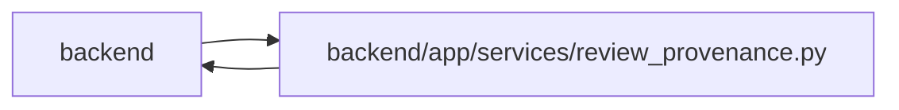

# review_provenance Module

**Path:** `backend/app/services/review_provenance.py`

## Description

Attribute task execution and bind independent review to its submitted candidate.

The review assignment binds the reviewer’s identity and model to a particular submission and artifact revision. The project can require a publisher distinct from every contributing publisher. An authenticated human executor can supply a manual candidate through the recorded start, resolution and current artifact. Agent execution history must be accounted for separately.

## Imports

| Source | Symbols |
|--------|---------|
| `__future__` | `annotations` |
| `app.commands` | `current_command`, `current_command` |
| `app.models.agent` | `AgentIdempotencyRecord`, `AgentModelBinding`, `AgentModelCatalogEntry`, `AgentRun`, `AgentRunEvent`, `TaskEvent`, `AgentTaskAssignment` |
| `app.models.external_link` | `ExternalLink` |
| `app.models.identity` | `Principal` |
| `app.models.project` | `Project` |
| `app.models.task_brief` | `TaskProgressRecord` |
| `app.models.team_member` | `TeamMemberProfile` |
| `app.query_limits` | `CollectionLimitExceededError`, `MAX_BOUNDED_LIST_ITEMS` |
| `app.services.agent_routing_policy` | `ROUTING_DECISION_AUTHORITY`, `canonical_routing_json_bytes` |
| `app.services.agent_routing_service` | `AgentRoutingConflictError`, `AgentRoutingService` |
| `app.services.github_status_service` | `GitHubStatusService` |
| `app.utils.github_links` | `GitHubLinkError`, `parse_github_url` |
| `app.utils.url_policy` | `normalize_stored_display_url` |
| `dataclasses` | `dataclass` |
| `hashlib` | `hashlib` |
| `httpx` | `httpx` |
| `json` | `json` |
| `re` | `re` |
| `sqlalchemy` | `select` |
| `sqlalchemy.orm` | `selectinload` |
| `urllib.parse` | `urlsplit` |

## Local dependency map

<!-- Auto-generated local dependency summary. Do not edit by hand. -->

> Module-level dependencies exceed the generated-diagram limits, so the diagram and table below group them by top-level package. Counts report the number of module neighbors in each package.

### Internal neighbors

| Direction | Module |
|---|---|
| Inbound | `backend` (8) |
| Outbound | `backend` (13) |

### External packages

| Language | Used packages | Undeclared packages |
|---|---:|---:|
| python | 2 | 0 |

> All 20 module neighbor(s) are summarized by package because the module-level view exceeds the 12-node limit.

## Classes

| Class | Line | Bases | Description |
|-------|------|-------|-------------|
| [ReviewHistory](../entities/ReviewHistory.md) | 213 | — | — |

## Functions

| Function | Signature | Decorators | Description |
|----------|-----------|------------|-------------|
| `_conflict` | `(code, message, **details)` | — | — |
| `digest` | `(value)` | — | — |
| `different_publisher_required` | *(async)* `(db, project_id)` | — | — |
| `historical_profile` | `(assignment)` | — | Only an exact server-owned selection can supply a legacy assignment's profile. |
| `actor_provenance` | *(async)* `(db, actor, *, observed_model = None, binding_id = None, lock = False)` | — | Capture the authenticated actor's profile and exact operator-declared model at this instant. |
| `_has_output` | `(value)` | — | — |
| `no_output_corroborated` | *(async)* `(db, run, reported_evidence = None)` | — | A sealed worker statement cannot discard artifacts already recorded on the same run. |
| `record_terminal_observation` | *(async)* `(db, actor, run, observed_model, *, submitting, output_state = None, commit_urls = (), evidence = None, checkpoint = False)` | — | Preserve a second contributing model on an interrupted or switched execution. |
| `recover_terminal_observation` | *(async)* `(db, run)` | — | Resolve only the server-bound receipt for a worker's final sealed checkpoint on this exact fence. |
| `mark_server_interruption` | *(async)* `(db, run)` | — | — |
| `_manual_history` | *(async)* `(db, task)` | — | Verify an actual human executor and immutable evidence, independently of the planned owner. |
| `review_history` | *(async)* `(db, task, assignments, *, strict)` | — | A failed or recovered run can have produced retained work. Include every actual attempt. |
| `_submission_candidate` | *(async)* `(db, task, submitted_run, source)` | — | Use identical repository and revision checks for authenticated worker or human artifact records. |
| `select_reviewer` | *(async)* `(db, task, assignments, reviewer, *, binding_id = None, reviewer_profile_id = None)` | — | — |
| `observe_review_candidate` | *(async)* `(db, assignment_id, actor_id)` | — | Resolve remote PR evidence before taking the task, actor and assignment locks. |
| `verify_verdict` | *(async)* `(db, task, assignments, assignment, actor, data, observed_candidate)` | — | — |
