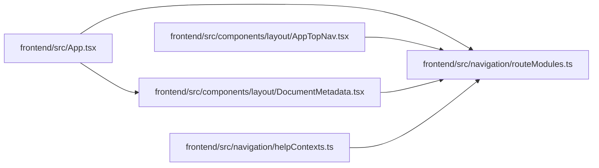

# routeModules Module

**Path:** `frontend/src/navigation/routeModules.ts`

## Description

_Auto-generated from `frontend/src/navigation/routeModules.ts`._

## Imports

| Source | Symbols | Type-only | Runtime emission |
|--------|---------|-----------|------------------|
| `react-router-dom` | `matchPath` | — | compiler-dependent |
| Unresolved `dynamic-import` | — (line 4; deferred) | — | unclassified |
| Unresolved `dynamic-import` | — (line 5; deferred) | — | unclassified |
| Unresolved `dynamic-import` | — (line 6; deferred) | — | unclassified |
| Unresolved `dynamic-import` | — (line 7; deferred) | — | unclassified |
| Unresolved `dynamic-import` | — (line 8; deferred) | — | unclassified |
| Unresolved `dynamic-import` | — (line 9; deferred) | — | unclassified |
| Unresolved `dynamic-import` | — (line 10; deferred) | — | unclassified |
| Unresolved `dynamic-import` | — (line 11; deferred) | — | unclassified |
| Unresolved `dynamic-import` | — (line 12; deferred) | — | unclassified |
| Unresolved `dynamic-import` | — (line 13; deferred) | — | unclassified |
| Unresolved `dynamic-import` | — (line 14; deferred) | — | unclassified |
| Unresolved `dynamic-import` | — (line 15; deferred) | — | unclassified |
| Unresolved `dynamic-import` | — (line 16; deferred) | — | unclassified |
| Unresolved `dynamic-import` | — (line 17; deferred) | — | unclassified |
| Unresolved `dynamic-import` | — (line 18; deferred) | — | unclassified |
| Unresolved `dynamic-import` | — (line 19; deferred) | — | unclassified |
| Unresolved `dynamic-import` | — (line 20; deferred) | — | unclassified |
| Unresolved `dynamic-import` | — (line 21; deferred) | — | unclassified |
| Unresolved `dynamic-import` | — (line 22; deferred) | — | unclassified |
| Unresolved `dynamic-import` | — (line 23; deferred) | — | unclassified |
| Unresolved `dynamic-import` | — (line 24; deferred) | — | unclassified |
| Unresolved `dynamic-import` | — (line 25; deferred) | — | unclassified |

## Module Signals

| Signal | Values |
|--------|--------|
| Exports | `RouteModuleKey`, `metadataForPath`, `routeMetadata`, `routeModuleLoaders`, `warmRouteModule` |
| Constants | `routeModuleLoaders`, `routeMetadata` |

## Local dependency map

<!-- Auto-generated local dependency summary. Do not edit by hand. -->
This graph shows full source coupling. Type dependencies can be erased; compiler-dependent cycle groups are runtime candidates, not confirmed initialization cycles.

### Internal neighbors

| Direction | Module |
|---|---|
| Inbound | [App](../modules/App.md) |
| Inbound | [AppTopNav](../modules/AppTopNav.md) |
| Inbound | [DocumentMetadata](../modules/DocumentMetadata.md) |
| Inbound | [helpContexts](../modules/helpContexts.md) |

### External packages

| Language | Used packages | Undeclared packages |
|---|---:|---:|
| typescript | 1 | 0 |

## Classes

| Class | Kind | Line | Bases / Target | Description |
|-------|------|------|----------------|-------------|
| [RouteModuleKey](../entities/RouteModuleKey.md) | Type alias | 28 | `keyof typeof routeModuleLoaders` | — |
| [RouteMetadata](../entities/RouteMetadata.md) | Type alias | 30 | <pre><code>&#123;&#10;    key&#58; RouteModuleKey&#59;&#10;    path&#58; string&#59;&#10;    titleKey&#58; string&#59;&#10;&#125;</code></pre> | — |

## Functions

| Function | Signature | Decorators | Description |
|----------|-----------|------------|-------------|
| `metadataForPath` | `(pathname: string) -> RouteMetadata` | — | — |
| `warmRouteModule` | *(async)* `(pathname: string)` | — | — |
