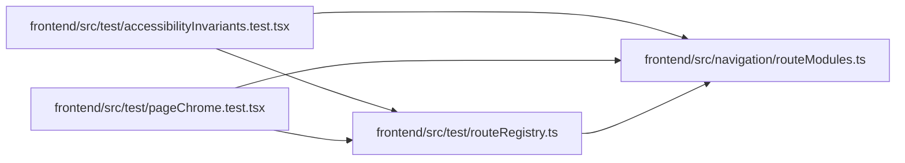

# routeRegistry Module

**Path:** `frontend/src/test/routeRegistry.ts`

## Description

_Auto-generated from `frontend/src/test/routeRegistry.ts`._

## Imports

| Source | Symbols | Type-only | Runtime emission |
|--------|---------|-----------|------------------|
| `../navigation/routeModules` | `RouteModuleKey` | Declaration | erased |

## Module Signals

| Signal | Values |
|--------|--------|
| Exports | `routeRegistry` |
| Constants | `routeRegistry` |

## Local dependency map

<!-- Auto-generated local dependency summary. Do not edit by hand. -->
This graph shows full source coupling. Type dependencies can be erased; compiler-dependent cycle groups are runtime candidates, not confirmed initialization cycles.

### Internal neighbors

| Direction | Module |
|---|---|
| Inbound | [accessibilityInvariants.test](../modules/accessibilityInvariants.test.md) |
| Inbound | [pageChrome.test](../modules/pageChrome.test.md) |
| Outbound | [routeModules](../modules/routeModules.md) |

## Classes

| Class | Kind | Line | Bases / Target | Description |
|-------|------|------|----------------|-------------|
| [RouteStatus](../entities/RouteStatus.md) | Type alias | 3 | `{ key: RouteModuleKey; status: 'migrated' \| 'pending'; path: string }` | — |
