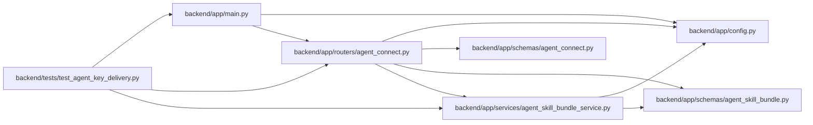

# agent_connect Module

**Path:** `backend/app/routers/agent_connect.py`

## Description

Public, secret-free hint telling an agent how to connect and obtain a key.

## Imports

| Source | Symbols |
|--------|---------|
| `__future__` | `annotations` |
| `app.config` | `get_settings` |
| `app.schemas.agent_connect` | `AgentConnectCredential`, `AgentConnectResponse`, `AgentConnectRole` |
| `app.schemas.agent_skill_bundle` | `SkillBundleCatalogResponse` |
| `app.services.agent_skill_bundle_service` | `AgentSkillBundleService`, `SkillBundleArtifactError`, `SkillBundleNotFoundError` |
| `fastapi` | `APIRouter`, `Depends` |
| `typing` | `Annotated` |

## Local dependency map

<!-- Auto-generated local dependency summary. Do not edit by hand. -->

### Internal neighbors

| Direction | Module |
|---|---|
| Inbound | [app_main](../modules/app_main.md) |
| Inbound | [test_agent_key_delivery](../modules/test_agent_key_delivery.md) |
| Outbound | [config](../modules/config.md) |
| Outbound | [schemas_agent_connect](../modules/schemas_agent_connect.md) |
| Outbound | [agent_skill_bundle](../modules/agent_skill_bundle.md) |
| Outbound | [agent_skill_bundle_service](../modules/agent_skill_bundle_service.md) |

### External packages

| Language | Used packages | Undeclared packages |
|---|---:|---:|
| python | 1 | 0 |

## Functions

| Function | Signature | Decorators | Description |
|----------|-----------|------------|-------------|
| `get_agent_connect_bundle_service` | *(async)* `() -> AgentSkillBundleService` | — | Read role scopes from the same deployed catalog the skill routes serve. |
| `_roles` | `(service: AgentSkillBundleService) -> list[AgentConnectRole]` | — | — |
| `get_agent_connect_hint` | *(async)* `(service: Annotated[AgentSkillBundleService, Depends(get_agent_connect_bundle_service)]) -> AgentConnectResponse` | `@router.get('/.well-known/workchord/agent-connect.json', response_model=AgentConnectResponse)` | Tell an unauthenticated agent where to connect and what key it needs. |
