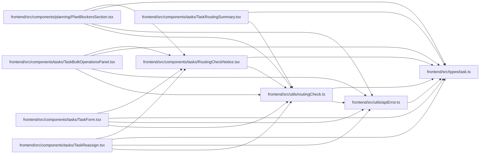

# routingCheck Module

**Path:** `frontend/src/utils/routingCheck.ts`

## Description

_Auto-generated from `frontend/src/utils/routingCheck.ts`._

## Imports

| Source | Symbols | Type-only | Runtime emission |
|--------|---------|-----------|------------------|
| `../types/task` | `RoutingCheck`, `RoutingIssue`, `RoutingReviewer`, `RoutingRung`, `TaskBulkOperationResult`, `TaskRouting` | Declaration | erased |
| `./apiError` | `normalizeApiError` | — | compiler-dependent |
| `i18next` | `TFunction` | Declaration | erased |

## Module Signals

| Signal | Values |
|--------|--------|
| Exports | `ROUTING_INCONSISTENT`, `RoutingChangeItem`, `resultsNeedingRouting`, `routingChangeItems`, `routingChangeLines`, `routingCheckFromError`, `routingConflicts`, `routingNeedsResolution`, `routingShape`, `rungLabel`, `suggestedReviewerOf` |
| Constants | `ROUTING_INCONSISTENT` |

## Local dependency map

<!-- Auto-generated local dependency summary. Do not edit by hand. -->
This graph shows full source coupling. Type dependencies can be erased; compiler-dependent cycle groups are runtime candidates, not confirmed initialization cycles.

### Internal neighbors

| Direction | Module |
|---|---|
| Inbound | [PlanBlockersSection](../modules/PlanBlockersSection.md) |
| Inbound | [RoutingCheckNotice](../modules/RoutingCheckNotice.md) |
| Inbound | [TaskBulkOperationsPanel](../modules/TaskBulkOperationsPanel.md) |
| Inbound | [TaskForm](../modules/TaskForm.md) |
| Inbound | [TaskReassign](../modules/TaskReassign.md) |
| Inbound | [TaskRoutingSummary](../modules/TaskRoutingSummary.md) |
| Outbound | [types_task](../modules/types_task.md) |
| Outbound | [apiError](../modules/apiError.md) |

### External packages

| Language | Used packages | Undeclared packages |
|---|---:|---:|
| typescript | 1 | 0 |

## Classes

| Class | Kind | Line | Bases / Target | Description |
|-------|------|------|----------------|-------------|
| [RoutingChangeItem](../entities/RoutingChangeItem.md) | Interface | 60 | — | One task of a bulk reassignment whose routing the suggestion would rewrite, or that has no suggestion. |

## Functions

| Function | Signature | Decorators | Description |
|----------|-----------|------------|-------------|
| `routingConflicts` | `(check: RoutingCheck)` | — | The issues the project's review policy treats as blocking. |
| `routingNeedsResolution` | `(check: RoutingCheck \| null \| undefined) -> check is RoutingCheck` | — | True when saving the change would leave the task with a routing the project policy does not allow. |
| `suggestedReviewerOf` | `(check: RoutingCheck) -> RoutingReviewer \| null` | — | The reviewer a check proposes: the dedicated field first, then the suggestion's own reviewer. |
| `routingCheckFromError` | `(error: unknown) -> RoutingCheck \| null` | — | The routing check the server returns with a refused change (409 `routing_inconsistent`), or null for any other error. |
| `resultsNeedingRouting` | `(results: TaskBulkOperationResult[])` | — | Bulk results whose reassignment needs a decision about the routing, whether refused or only warned. |
| `rungLabel` | `(t: TFunction, rung: RoutingRung \| RoutingReviewer)` | — | A model catalog entry as people read it: its key, effort and publisher. |
| `routingChangeLines` | `(t: TFunction, before: TaskRouting \| null \| undefined, after: TaskRouting \| null \| undefined)` | — | What saving a suggested routing changes, one line per part that differs, for people to read before they accept it. |
| `routingShape` | `(routing: TaskRouting \| null \| undefined)` | — | The model keys a routing names, to tell whether two routings send the work the same way. |
| `routingChangeItems` | `(needing: TaskBulkOperationResult[], applied: TaskBulkOperationResult[]) -> RoutingChangeItem[]` | — | The tasks a "use the suggested routing" confirmation would touch: every task whose dry run with the |
