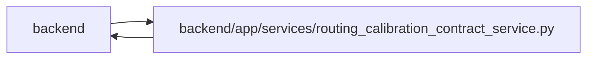

# routing_calibration_contract_service Module

**Path:** `backend/app/services/routing_calibration_contract_service.py`

## Description

The deployment's calibration contracts for performance-informed routing.

An operator submits a contract's complete terms and an operator approves
them as the contract's declared approver. Each command is replay-safe, carries a reason, adds
an append-only revision row and records an audit event. Routing consumes no
performance history: it only reports whether an approved contract exists.

## Imports

| Source | Symbols |
|--------|---------|
| `__future__` | `annotations` |
| `app.authority` | `internal_authority` |
| `app.models.agent` | `AgentActor`, `TaskEvent` |
| `app.models.routing_calibration` | `RoutingCalibrationContract`, `RoutingCalibrationContractRevision` |
| `app.query_limits` | `CollectionLimitExceededError`, `MAX_BOUNDED_LIST_ITEMS` |
| `app.schemas.agent_planning` | `AgentPlanningCommandContext` |
| `app.schemas.agent_routing` | `AgentModelMutationReceipt` |
| `app.schemas.routing_calibration` | `CALIBRATION_CONTRACT_SCHEMA_VERSION`, `RoutingCalibrationContractApprove`, `RoutingCalibrationContractDetail`, `RoutingCalibrationContractListResponse`, `RoutingCalibrationContractResponse`, `RoutingCalibrationContractRevise`, `RoutingCalibrationContractRevisionResponse`, `RoutingCalibrationContractSubmit`, `RoutingCalibrationContractTerms` |
| `app.services.agent_model_catalog_service` | `AgentModelCatalogService`, `AgentModelConflictError`, `_MutationResult` |
| `app.services.agent_routing_policy` | `RoutingTermsRefusedError` |
| `app.services.agent_service` | `require_scope` |
| `app.services.routing_qualification_key_service` | `require_known_qualification_keys` |
| `app.utils.time` | `utc_now` |
| `datetime` | `timedelta` |
| `json` | `json` |
| `sqlalchemy` | `func`, `select`, `text` |
| `sqlalchemy.ext.asyncio` | `AsyncSession` |
| `sqlalchemy.orm` | `selectinload` |

## Local dependency map

<!-- Auto-generated local dependency summary. Do not edit by hand. -->

> Module-level dependencies exceed the generated-diagram limits, so the diagram and table below group them by top-level package. Counts report the number of module neighbors in each package.

### Internal neighbors

| Direction | Module |
|---|---|
| Inbound | `backend` (3) |
| Outbound | `backend` (12) |

### External packages

| Language | Used packages | Undeclared packages |
|---|---:|---:|
| python | 1 | 0 |

> All 15 module neighbor(s) are summarized by package because the module-level view exceeds the 12-node limit.

## Classes

| Class | Line | Bases | Description |
|-------|------|-------|-------------|
| [RoutingCalibrationContractService](../entities/RoutingCalibrationContractService.md) | 64 | — | Read contracts and run their deployment-operator commands. |

## Functions

| Function | Signature | Decorators | Description |
|----------|-----------|------------|-------------|
| `approved_calibration_contract_count` | *(async)* `(db: AsyncSession) -> int` | — | How many contracts are currently approved; routing reads nothing else from them. |
