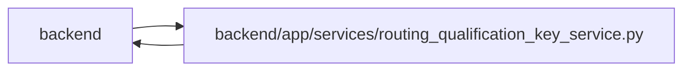

# routing_qualification_key_service Module

**Path:** `backend/app/services/routing_qualification_key_service.py`

## Description

The deployment's governed registry of qualification keys.

An operator declares, revises and retires keys here. Each change is one
replay-safe command with a reason, an append-only revision row and an audit
event. Catalog entries and task routing requirements may then name a declared
key beside the built-in routing skill keys, which stay fixed in code.

## Imports

| Source | Symbols |
|--------|---------|
| `__future__` | `annotations` |
| `app.authority` | `internal_authority` |
| `app.models.agent` | `AgentActor`, `AgentModelCatalogEntry`, `TaskEvent`, `TaskRoutingAssessment` |
| `app.models.routing_calibration` | `RoutingCalibrationContract` |
| `app.models.routing_qualification` | `RoutingQualificationKey`, `RoutingQualificationKeyRevision` |
| `app.models.task` | `Task` |
| `app.query_limits` | `CollectionLimitExceededError`, `MAX_BOUNDED_LIST_ITEMS` |
| `app.schemas.agent_planning` | `AgentPlanningCommandContext` |
| `app.schemas.agent_routing` | `AgentModelMutationReceipt` |
| `app.schemas.routing_qualification` | `MAX_QUALIFICATION_KEY_USAGE_ITEMS`, `QualificationKeyCalibrationReference`, `QualificationKeyCatalogReference`, `RoutingQualificationKeyDeclare`, `RoutingQualificationKeyDetail`, `RoutingQualificationKeyRegistryResponse`, `RoutingQualificationKeyResponse`, `RoutingQualificationKeyRetire`, `RoutingQualificationKeyRevise`, `RoutingQualificationKeyRevisionResponse`, `RoutingQualificationKeyUsage` |
| `app.services.agent_model_catalog_service` | `AgentModelCatalogService`, `AgentModelConflictError`, `_MutationResult` |
| `app.services.agent_routing_policy` | `ROUTING_POLICY_VERSION`, `ROUTING_SKILL_KEYS`, `require_known_routing_keys` |
| `app.services.agent_service` | `require_scope` |
| `app.utils.time` | `utc_now` |
| `collections.abc` | `Iterable` |
| `json` | `json` |
| `sqlalchemy` | `String`, `bindparam`, `cast`, `select`, `text` |
| `sqlalchemy.ext.asyncio` | `AsyncSession` |
| `sqlalchemy.orm` | `selectinload` |

## Local dependency map

<!-- Auto-generated local dependency summary. Do not edit by hand. -->

> Module-level dependencies exceed the generated-diagram limits, so the diagram and table below group them by top-level package. Counts report the number of module neighbors in each package.

### Internal neighbors

| Direction | Module |
|---|---|
| Inbound | `backend` (7) |
| Outbound | `backend` (13) |

### External packages

| Language | Used packages | Undeclared packages |
|---|---:|---:|
| python | 1 | 0 |

> All 19 module neighbor(s) are summarized by package because the module-level view exceeds the 12-node limit.

## Classes

| Class | Line | Bases | Description |
|-------|------|-------|-------------|
| [RoutingQualificationKeyService](../entities/RoutingQualificationKeyService.md) | 135 | — | Read the registry and run its deployment-operator commands. |

## Functions

| Function | Signature | Decorators | Description |
|----------|-----------|------------|-------------|
| `_lock_keys` | *(async)* `(db: AsyncSession, names: Iterable[str]) -> None` | — | Take SQLite's database write lock before reading the named keys. |
| `active_qualification_keys` | *(async)* `(db: AsyncSession, keys: Iterable[str] \| None = None, *, lock: bool = False) -> frozenset[str]` | — | Return active declared keys, optionally only those named and share-locked. |
| `require_known_qualification_keys` | *(async)* `(db: AsyncSession, keys: Iterable[str], *, lock: bool = True) -> tuple[str, ...]` | — | Refuse a key that is neither built in nor declared and active. |
