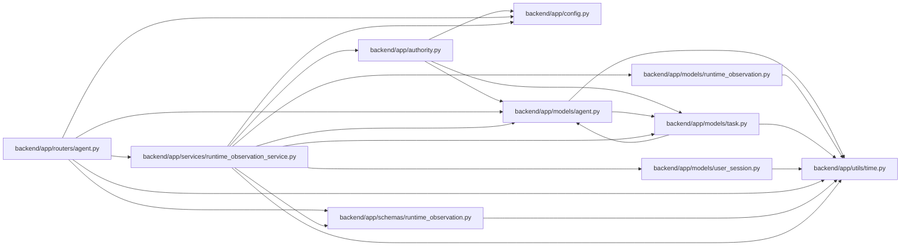

# runtime_observation_service Module

**Path:** `backend/app/services/runtime_observation_service.py`

## Description

Record and read advisory runtime observations.

Observations come from independent observers, such as a dashboard watching
agent sessions on a host. They are advisory: recording one writes only its own
row, never an actor, assignment, run, task event, topology member or webhook,
and no dispatch, routing or readiness code reads them.

## Imports

| Source | Symbols |
|--------|---------|
| `app.authority` | `AuthorityError`, `internal_authority`, `require_operator` |
| `app.config` | `get_settings` |
| `app.models.agent` | `AgentActor`, `AgentRun`, `AgentTaskAssignment` |
| `app.models.runtime_observation` | `AgentRuntimeObservation` |
| `app.models.task` | `Task` |
| `app.models.user_session` | `UserSession` |
| `app.schemas.runtime_observation` | `AgentRuntimeObservationCreate` |
| `app.utils.time` | `utc_now`, `as_utc` |
| `datetime` | `timedelta` |
| `sqlalchemy` | `delete`, `func`, `select` |

## Local dependency map

<!-- Auto-generated local dependency summary. Do not edit by hand. -->

### Internal neighbors

| Direction | Module |
|---|---|
| Inbound | [routers_agent](../modules/routers_agent.md) |
| Outbound | [authority](../modules/authority.md) |
| Outbound | [config](../modules/config.md) |
| Outbound | [models_agent](../modules/models_agent.md) |
| Outbound | [models_runtime_observation](../modules/models_runtime_observation.md) |
| Outbound | [models_task](../modules/models_task.md) |
| Outbound | [user_session](../modules/user_session.md) |
| Outbound | [schemas_runtime_observation](../modules/schemas_runtime_observation.md) |
| Outbound | [time](../modules/time.md) |

### External packages

| Language | Used packages | Undeclared packages |
|---|---:|---:|
| python | 1 | 0 |

## Classes

| Class | Line | Bases | Description |
|-------|------|-------|-------------|
| [RuntimeObservationService](../entities/RuntimeObservationService.md) | 26 | — | — |

## Functions

| Function | Signature | Decorators | Description |
|----------|-----------|------------|-------------|
| `_same` | `(stored, requested)` | — | — |
