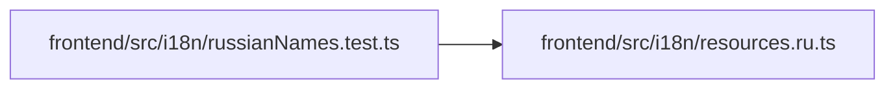

# russianNames.test Module

**Path:** `frontend/src/i18n/russianNames.test.ts`

## Description

_Auto-generated from `frontend/src/i18n/russianNames.test.ts`._

## Imports

| Source | Symbols | Type-only | Runtime emission |
|--------|---------|-----------|------------------|
| `./resources.ru` | `russianResources` | — | compiler-dependent |
| `vitest` | `describe`, `expect`, `it` | — | compiler-dependent |

## Module Signals

| Signal | Values |
|--------|--------|
| Constants | `RETIRED_TERMS`, `ALLOWED_STRINGS` |
| Module calls | `ALLOWED_STRINGS = Set`, `describe` |

## Local dependency map

<!-- Auto-generated local dependency summary. Do not edit by hand. -->

### Internal neighbors

| Direction | Module |
|---|---|
| Outbound | [resources.ru](../modules/resources.ru.md) |

### External packages

| Language | Used packages | Undeclared packages |
|---|---:|---:|
| typescript | 1 | 0 |
