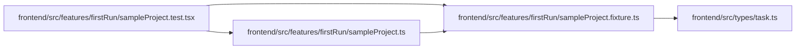

# sampleProject.fixture Module

**Path:** `frontend/src/features/firstRun/sampleProject.fixture.ts`

## Description

_Auto-generated from `frontend/src/features/firstRun/sampleProject.fixture.ts`._

## Imports

| Source | Symbols | Type-only | Runtime emission |
|--------|---------|-----------|------------------|
| `../../types/task` | `TaskBrief` | Declaration | erased |

## Module Signals

| Signal | Values |
|--------|--------|
| Exports | `sampleProjectFixture` |
| Constants | `english`, `russian` |

## Local dependency map

<!-- Auto-generated local dependency summary. Do not edit by hand. -->
This graph shows full source coupling. Type dependencies can be erased; compiler-dependent cycle groups are runtime candidates, not confirmed initialization cycles.

### Internal neighbors

| Direction | Module |
|---|---|
| Inbound | [sampleProject.test](../modules/sampleProject.test.md) |
| Inbound | [sampleProject](../modules/sampleProject.md) |
| Outbound | [types_task](../modules/types_task.md) |

## Functions

| Function | Signature | Decorators | Description |
|----------|-----------|------------|-------------|
| `sampleProjectFixture` | `(language: string, now = new Date())` | — | — |
