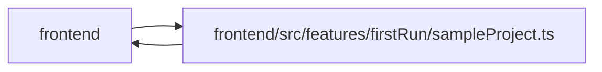

# sampleProject Module

**Path:** `frontend/src/features/firstRun/sampleProject.ts`

## Description

_Auto-generated from `frontend/src/features/firstRun/sampleProject.ts`._

## Imports

| Source | Symbols | Type-only | Runtime emission |
|--------|---------|-----------|------------------|
| `../../services/ganttService` | `ganttService` | — | compiler-dependent |
| `../../services/iterationService` | `iterationService` | — | compiler-dependent |
| `../../services/planningInputService` | `planningInputService` | — | compiler-dependent |
| `../../services/projectService` | `projectService` | — | compiler-dependent |
| `../../services/taskService` | `taskService` | — | compiler-dependent |
| `../../services/teamService` | `teamService` | — | compiler-dependent |
| `../identity/identityService` | `WorkProfile` | Declaration | erased |
| `../scope/workScope` | `WorkScope` | Declaration | erased |
| `./sampleProject.fixture` | `sampleProjectFixture` | — | compiler-dependent |

## Module Signals

| Signal | Values |
|--------|--------|
| Exports | `SampleKind`, `SampleManifest`, `SampleRecord`, `SampleWindowUnavailableError`, `SaveSample`, `loadSampleProject`, `removeSampleProject` |

## Local dependency map

<!-- Auto-generated local dependency summary. Do not edit by hand. -->
This graph shows full source coupling. Type dependencies can be erased; compiler-dependent cycle groups are runtime candidates, not confirmed initialization cycles.

> Module-level dependencies exceed the generated-diagram limits, so the diagram and table below group them by top-level package. Counts report the number of module neighbors in each package.

### Internal neighbors

| Direction | Module |
|---|---|
| Inbound | `frontend` (3) |
| Outbound | `frontend` (9) |

> All 12 module neighbor(s) are summarized by package because the module-level view exceeds the 12-node limit.

## Classes

| Class | Kind | Line | Bases / Target | Description |
|-------|------|------|----------------|-------------|
| [SampleWindowUnavailableError](../entities/SampleWindowUnavailableError.md) | Class | 15 | `Error` | — |
| [SampleRecord](../entities/SampleRecord.md) | Interface | 12 | — | — |
| [SampleManifest](../entities/SampleManifest.md) | Interface | 13 | — | — |
| [SampleKind](../entities/SampleKind.md) | Type alias | 11 | `'project' \| 'milestone' \| 'iteration' \| 'profile' \| 'member' \| 'task'` | — |
| [SaveSample](../entities/SaveSample.md) | Type alias | 14 | `(manifest: SampleManifest) => void` | — |

## Functions

| Function | Signature | Decorators | Description |
|----------|-----------|------------|-------------|
| `loadSampleProject` | *(async)* `(manifest: SampleManifest, person: WorkProfile, language: string, save: SaveSample)` | — | Keep the receipt after each successful call, including before any subsequent call can fail. |
| `removeSampleProject` | *(async)* `(manifest: SampleManifest, save: SaveSample)` | — | Delete only recorded IDs, children first. Stop if a container acquired other work. |
