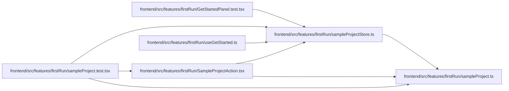

# sampleProjectStore Module

**Path:** `frontend/src/features/firstRun/sampleProjectStore.ts`

## Description

_Auto-generated from `frontend/src/features/firstRun/sampleProjectStore.ts`._

## Imports

| Source | Symbols | Type-only | Runtime emission |
|--------|---------|-----------|------------------|
| `./sampleProject` | `SampleManifest` | Declaration | erased |
| `zustand` | `create` | — | compiler-dependent |

## Module Signals

| Signal | Values |
|--------|--------|
| Exports | `useSampleProject` |
| Constants | `STORAGE_KEY`, `useSampleProject` |
| Module calls | `useSampleProject = create` |

## Local dependency map

<!-- Auto-generated local dependency summary. Do not edit by hand. -->
This graph shows full source coupling. Type dependencies can be erased; compiler-dependent cycle groups are runtime candidates, not confirmed initialization cycles.

### Internal neighbors

| Direction | Module |
|---|---|
| Inbound | [GetStartedPanel.test](../modules/GetStartedPanel.test.md) |
| Inbound | [sampleProject.test](../modules/sampleProject.test.md) |
| Inbound | [SampleProjectAction](../modules/SampleProjectAction.md) |
| Inbound | [useGetStarted](../modules/useGetStarted.md) |
| Outbound | [sampleProject](../modules/sampleProject.md) |

### External packages

| Language | Used packages | Undeclared packages |
|---|---:|---:|
| typescript | 1 | 0 |

## Classes

| Class | Kind | Line | Bases / Target | Description |
|-------|------|------|----------------|-------------|
| [SampleState](../entities/SampleState.md) | Interface | 17 | — | — |
