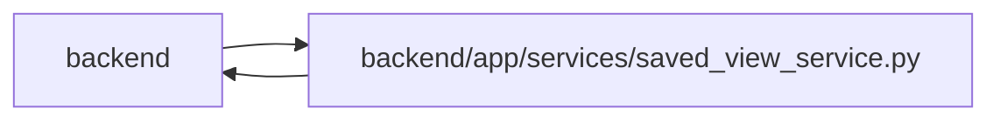

# saved_view_service Module

**Path:** `backend/app/services/saved_view_service.py`

## Description

Service for saved view persistence and filter payload compatibility.

Planning-issue filters (`unassigned`, `missing-effort`) use the shared rule in `planning_issues`: only planned, non-deferred leaves count, and agent-held work is not unassigned, so a filter returns exactly what the readiness count reports.

Task dashboard cards count matching leaves. Personal ownership follows the durable principal after explicit guest transfer, retaining original session attribution. Legacy overdue predicates migrate to explicit iteration overflow with a disclosure note, while new overdue predicates mean open delivery already past its expected finish.
The built-in Blocked view filters on the reported blocker state (`isBlocked`), not on a label, so it matches the project's blocked count and agent-reported blockers.

## Imports

| Source | Symbols |
|--------|---------|
| `app.commands` | `commit_or_flush` |
| `app.models.iteration` | `Iteration` |
| `app.models.saved_view` | `SavedView` |
| `app.schemas.saved_view` | `SavedViewCreate`, `SavedViewCreateRequest`, `SavedViewDashboardCardResponse`, `SavedViewDuplicateRequest`, `SavedViewResponse`, `SavedViewScope`, `SavedViewType`, `SavedViewUpdate`, `SavedViewUpdateRequest` |
| `app.services.label_service` | `LabelService` |
| `app.services.planning_issues` | `missing_effort`, `needs_assignee` |
| `app.services.project_service` | `ProjectService` |
| `app.services.task_service` | `TaskService` |
| `app.services.triage_service` | `TriageService` |
| `datetime` | `date` |
| `sqlalchemy` | `Select`, `or_`, `select` |
| `sqlalchemy.ext.asyncio` | `AsyncSession` |
| `typing` | `Any`, `Optional`, `Sequence` |

## Local dependency map

<!-- Auto-generated local dependency summary. Do not edit by hand. -->

> Module-level dependencies exceed the generated-diagram limits, so the diagram and table below group them by top-level package. Counts report the number of module neighbors in each package.

### Internal neighbors

| Direction | Module |
|---|---|
| Inbound | `backend` (5) |
| Outbound | `backend` (9) |

### External packages

| Language | Used packages | Undeclared packages |
|---|---:|---:|
| python | 1 | 0 |

> All 14 module neighbor(s) are summarized by package because the module-level view exceeds the 12-node limit.

## Classes

| Class | Line | Bases | Description |
|-------|------|-------|-------------|
| [SavedViewPermissionError](../entities/SavedViewPermissionError.md) | 25 | `PermissionError` | Raised when a session cannot mutate a saved view. |
| [SavedViewValidationError](../entities/SavedViewValidationError.md) | 29 | `ValueError` | Raised when a saved view payload is invalid. |
| [SavedViewService](../entities/SavedViewService.md) | 174 | — | Service for saved view CRUD and compatibility-safe read models. |