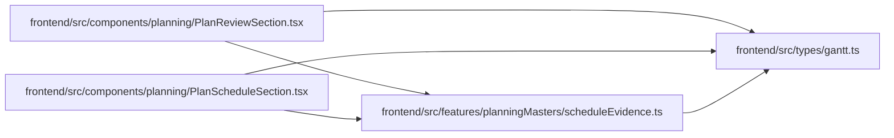

# scheduleEvidence Module

**Path:** `frontend/src/features/planningMasters/scheduleEvidence.ts`

## Description

_Auto-generated from `frontend/src/features/planningMasters/scheduleEvidence.ts`._

## Imports

| Source | Symbols | Type-only | Runtime emission |
|--------|---------|-----------|------------------|
| `../../types/gantt` | `GanttTask` | Declaration | erased |

## Module Signals

| Signal | Values |
|--------|--------|
| Exports | `scheduleLeaves` |

## Local dependency map

<!-- Auto-generated local dependency summary. Do not edit by hand. -->
This graph shows full source coupling. Type dependencies can be erased; compiler-dependent cycle groups are runtime candidates, not confirmed initialization cycles.

### Internal neighbors

| Direction | Module |
|---|---|
| Inbound | [PlanReviewSection](../modules/PlanReviewSection.md) |
| Inbound | [PlanScheduleSection](../modules/PlanScheduleSection.md) |
| Outbound | [types_gantt](../modules/types_gantt.md) |

## Functions

| Function | Signature | Decorators | Description |
|----------|-----------|------------|-------------|
| `scheduleLeaves` | `(tasks: GanttTask[], deferred = false) -> GanttTask[]` | — | — |
