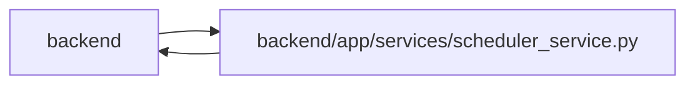

# scheduler_service Module

**Path:** `backend/app/services/scheduler_service.py`

## Description

Builds forecasts from canonical person calendars and shared absences, retaining actual execution dates. Productive-hour reservations include shortened days, existing execution slots and overflow dates. Preview and apply use the same shared planning revision. A forecast may overflow, but a new commitment must fit allocation dates and shared capacity; accepted baselines are changed only through deliberate rebaselining.

YAML and fallback scheduling, incremental rescheduling and reservations use complete inherited deferred and optional policy. Deferred descendants cannot consume schedule capacity or acquire forecast dates through these paths.

A calculation may also follow actual dates. Given the day a task started or was submitted, it places planned work on or after that day, lets finished work free its assignee from that day, keeps running work on its assignee at least through it, and leaves the dates of work it cannot place. The task that just started takes its assignee's row first. When only a task's dates change, its queued agent assignments move to the new task version; model-aware assignments do not, because their routing evidence is bound to the exact version.

## Imports

| Source | Symbols |
|--------|---------|
| `app.authority` | `internal_authority` |
| `app.commands` | `atomic_command`, `command_transaction`, `commit_or_flush`, `lock_iterations`, `lock_planning`, `PlanningConflict`, `current_command` |
| `app.models.agent` | `AgentTaskAssignment` |
| `app.models.iteration` | `Iteration` |
| `app.models.project` | `Project` |
| `app.models.recovery` | `TaskScheduleBaseline` |
| `app.models.task` | `Task`, `TaskDependency`, `TaskStatus`, `TaskStatus`, `TaskStatus` |
| `app.models.team_member` | `TeamMember`, `Vacation` |
| `app.schemas.gantt` | `SchedulingDecision`, `ScheduleResult`, `UnscheduledTask`, `WorkloadIssue` |
| `app.services.agent_work_service` | `AgentWorkService` |
| `app.services.calendar_service` | `CalendarService` |
| `app.services.capacity_service` | `CapacityService`, `CapacityService` |
| `app.services.delivery_dependency_service` | `DeliveryDependencyService` |
| `app.services.iteration_service` | `IterationService`, `IterationService` |
| `app.services.scheduling_rules_service` | `SchedulingRulesService` |
| `app.services.task_service` | `TaskService` |
| `app.services.team_service` | `TeamService` |
| `app.services.work_metrics` | `effective_work_flags`, `effective_work_flags`, `effective_work_flags` |
| `asyncio` | `asyncio` |
| `collections` | `defaultdict`, `defaultdict`, `defaultdict` |
| `dataclasses` | `dataclass`, `field` |
| `datetime` | `date`, `timedelta` |
| `enum` | `Enum` |
| `logging` | `logging` |
| `math` | `math` |
| `sqlalchemy` | `select` |
| `sqlalchemy.ext.asyncio` | `AsyncSession` |
| `typing` | `Any`, `Callable`, `Optional`, `Sequence` |

## Local dependency map

<!-- Auto-generated local dependency summary. Do not edit by hand. -->

> Module-level dependencies exceed the generated-diagram limits, so the diagram and table below group them by top-level package. Counts report the number of module neighbors in each package.

### Internal neighbors

| Direction | Module |
|---|---|
| Inbound | `backend` (11) |
| Outbound | `backend` (18) |

### External packages

| Language | Used packages | Undeclared packages |
|---|---:|---:|
| python | 1 | 0 |

> All 28 module neighbor(s) are summarized by package because the module-level view exceeds the 12-node limit.

## Classes

| Class | Kind | Line | Bases / Target | Description |
|-------|------|------|----------------|-------------|
| [ChangeType](../entities/ChangeType.md) | Enum | 26 | `Enum` | Types of changes that trigger incremental rescheduling. |
| [TaskChange](../entities/TaskChange.md) | Class | 40 | — | Represents a change to a task for incremental rescheduling. |
| [RescheduleResult](../entities/RescheduleResult.md) | Class | 51 | — | Result of an incremental reschedule operation. |
| [MemberSchedule](../entities/MemberSchedule.md) | Class | 61 | — | Optimized schedule tracking with O(D) slot finding using sliding window. |
| [SchedulerService](../entities/SchedulerService.md) | Class | 307 | — | Service for automatic task scheduling. |
| [IncrementalScheduler](../entities/IncrementalScheduler.md) | Class | 1497 | — | Handles incremental rescheduling when a single task changes. |

## Functions

| Function | Signature | Decorators | Description |
|----------|-----------|------------|-------------|
| `rebind_queued_assignments` | *(async)* `(db: AsyncSession, task_id: int, previous_version: int, new_version: int) -> None` | — | Keep queued dispatch valid when only a task's dates changed. |